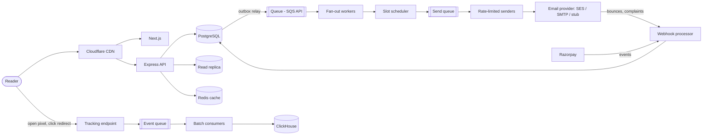
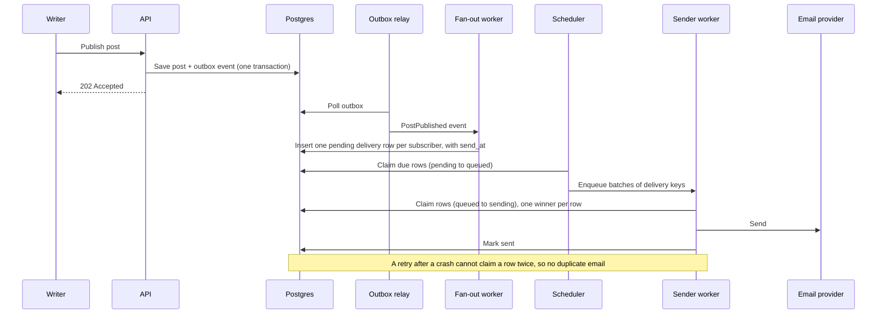

<div align="center">

# Vichaar

**Newsletter infrastructure for Indian writers, built to survive its own success.**

A Substack-style publishing platform for writers in any Indian language, priced in rupees.
The product is small and the engineering is not: reliable email fan-out, a cache-first read path,
and an event pipeline that never writes a click to the primary database.

[](https://github.com/Dumbsham/Vichaar/actions/workflows/ci.yml)


[Live demo](#) · [System design](docs/design.md) · [Flows](docs/flows.md) · [Decision records](docs/adr) · [Benchmarks](docs/benchmarks.md)

</div>

> **Status:** design complete, implementation starting. The roadmap below tracks progress, and benchmark numbers are only published once they have been measured.

---

## Why this project exists

Anyone can build a CRUD app that stores posts and emails them in a `for` loop. That version works for 50 subscribers and collapses at 50,000. Vichaar is an exercise in building the version that keeps working: every design choice is a response to a specific failure mode, documented in an ADR and covered by a test.

It is also built under a real constraint: the whole demo runs on a single free-tier VM. The architecture is production-shaped, the deployment is honest about being small, and every number in this repository says what it was measured on.

## The hard problems

| Problem | Why the obvious approach fails | What Vichaar does |
|---|---|---|
| **Send one post to 500k subscribers** | A loop in a request handler times out, double-sends on retry, and lets one large publication starve everyone else | Transactional outbox, database-driven slot scheduling, batched fan-out, atomic per-email claims (at most once), per-publication fair scheduling, dead-letter queue |
| **Serve a write-once, read-millions workload** | Rendering from the database on every request melts under a traffic spike | Pages rendered to static HTML on publish, served CDN → Redis → read replica, with targeted invalidation on edit |
| **Track opens and clicks** | One database write per event takes down the primary | Edge endpoint → queue → batched ClickHouse inserts → pre-aggregated rollups |
| **Enforce a paywall** | Billing webhooks arrive late, twice, or out of order, so access drifts from reality | Idempotent handlers, event-version comparison, reconciliation job, cached entitlements that fail closed |
| **Land in the inbox** | Bounces and spam complaints silently destroy sender reputation | SPF/DKIM/DMARC, bounce and complaint webhooks feeding a suppression list, per-publication complaint thresholds |

## Features

**Writers**
- Publication on its own subdomain (`name.vichaar.in`)
- Rich-text editor, drafts, scheduled publishing
- One monthly price per publication in rupees, paid-only posts
- A language tag on every post (Hindi, English, Tamil, and more)
- Analytics for opens, clicks, subscriber growth and paid conversion
- Milestone celebrations (10, 100, 1,000 subscribers) and a weekly writing streak

**Readers**
- Double opt-in, one-click unsubscribe
- Choose a delivery slot (morning, afternoon, evening) and receive posts at that time in their own timezone
- Read on the web or in the inbox, pay in rupees through Razorpay
- Select a line from a post and share it as an image card on WhatsApp or Instagram

**Platform**
- Strict per-publication tenant isolation
- Suppression lists and complaint-based sending limits
- Structured logs, metrics, traces and alerting

Custom domains are planned for v2.

## Architecture



Vichaar is a **modular monolith** with separately scaled worker processes. A service is only split out when scaling or failure isolation demands it ([ADR-001](docs/adr/001-modular-monolith.md)). The queue, the email provider and object storage sit behind interfaces, so the same code runs against ElasticMQ, a stub and local disk in the demo, and against SQS, SES and S3 in production.

### How a post gets delivered



The outbox guarantees a post is never saved without its send event being recorded. The atomic claim guarantees only one worker can send a given email, so a retry never produces a duplicate. If a worker dies mid-send, that email's outcome is unknown: it is flagged, counted, and never resent automatically ([ADR-009](docs/adr/009-slot-scheduling-and-delivery-semantics.md)). Every step is described in [docs/flows.md](docs/flows.md), and both properties are verified by the [chaos suite](#failure-testing).

## How the code is organized

The API is Express 5 with an explicit layered structure, because a small framework only stays clean if the rules are enforced.

```
HTTP route  →  service  →  repository  →  database
(Express)      (plain TS)   (Drizzle)
```

- **One folder per module** (`auth`, `publications`, `posts`, `subscriptions`, `billing`, `delivery`, `analytics`). A module exposes a single public `index.ts`, and other modules may only import from it. CI fails on violations.
- **Services contain no Express types,** so the API and the background workers call the same business logic.
- **Repositories take `publicationId` as a required argument,** so a query without tenant scoping does not compile.
- **One composition root** (`container.ts`) wires every dependency. Email, queue and storage providers are chosen by configuration.
- **Zod validates every boundary:** HTTP bodies, queue messages, webhooks and environment variables.

## Design targets

These are the numbers the system is designed and tested against. Derivations are in [docs/design.md](docs/design.md#capacity-estimation). Each target is checked by a named script, and measured results are published in [docs/benchmarks.md](docs/benchmarks.md).

| Target | Value | Verified by |
|---|---|---|
| Subscribers (platform) | 1,000,000 | `loadtests/seed.ts` |
| Largest single send | 500,000 recipients | `loadtests/send-500k.js` |
| Sustained send rate | 1,000 emails/sec (500k in about 8.3 min) | `loadtests/send-500k.js` |
| Post page read, cached | 1,000 req/sec, p95 under 100 ms | `loadtests/read-path.js` |
| Post page read, uncached | 100 req/sec, p95 under 300 ms | `loadtests/read-path.js` |
| Tracking event ingestion | 1,000 events/sec | `loadtests/events.js` |
| Slot accuracy | 99% of emails start within 5 min of their slot | `loadtests/slots.js` |
| Duplicate emails after a worker is killed mid-send | 0 | `chaos/kill-sender.test.ts` |
| Emails with unknown outcome after a crash | At most the sender's in-flight limit, all flagged | `chaos/kill-sender.test.ts` |
| Duplicate state change after webhook replay | 0 | `chaos/webhook-replay.test.ts` |

**What "measured" means here:** send-path benchmarks run against a stubbed email provider, because real email throughput is limited by the provider account, not by this code. Results always state the hardware (2 vCPU, 12 GB RAM), the commands, and the date.

## Deployment: demo and blueprint

| Concern | Demo deployment (runs live, free tier) | Production blueprint (Terraform, planned but not applied) |
|---|---|---|
| Compute | Docker Compose on one 2 vCPU / 12 GB VM | ECS services with autoscaling |
| Database | Postgres container plus a read-replica container | RDS multi-AZ with read replica |
| Cache | Redis container | ElastiCache |
| Queue | ElasticMQ (SQS-compatible) | Amazon SQS with dead-letter queues |
| Analytics | ClickHouse container with a memory cap | ClickHouse Cloud or a dedicated instance |
| Object storage | Local disk volume served by Caddy | S3 |
| Email | SES sandbox for real demo mail, stub for load tests | SES with production access |
| CDN, TLS, DNS | Cloudflare free plan, Caddy | CloudFront, ACM, Route 53 |
| Observability | Prometheus and Grafana containers | Same stack, managed or self-hosted |

The blueprint is validated with `terraform plan` and costed with Infracost, so the design is reviewable without a cloud bill. Resource limits for every container in the demo are documented in [docs/design.md](docs/design.md#resource-budget).

## Tech stack

| Layer | Choice |
|---|---|
| Language | TypeScript (strict) end to end |
| Frontend | Next.js (App Router), Tailwind CSS, Tiptap editor |
| API | Express 5, Zod validation, pino |
| Database | PostgreSQL with Drizzle ORM |
| Cache | Redis (cache and rate limits only, never durable state) |
| Queue | SQS API (ElasticMQ in the demo, SQS in the blueprint) |
| Analytics | ClickHouse |
| Email | Provider interface with SES, SMTP and stub implementations |
| Payments | Razorpay (test mode) |
| Images | Satori and resvg for quote cards, stored through an object-storage interface |
| Observability | OpenTelemetry, Prometheus, Grafana |
| Testing | Vitest, supertest, Playwright, k6 |
| Tooling | pnpm workspaces, Turborepo, GitHub Actions, Docker, Terraform |

## Quick start

**Requirements:** Node.js 20+, pnpm 9+, Docker.

```bash
git clone https://github.com/Dumbsham/vichaar.git
cd vichaar

pnpm install
cp .env.example .env
pnpm stack:up        # Postgres, Redis, ElasticMQ, ClickHouse, Mailpit
pnpm db:migrate
pnpm db:seed
pnpm dev             # web on :3000, API on :4000, workers
```

Outbound email is captured by Mailpit at `http://localhost:8025`, so nothing reaches a real inbox in development.

```bash
pnpm test            # unit and integration tests (real Postgres and Redis)
pnpm lint            # eslint, prettier, boundary rules, tsc --noEmit
pnpm loadtest        # k6 scenarios
pnpm chaos           # failure-injection suite
```

## Failure testing

Resilience is demonstrated, not claimed. `pnpm chaos` covers:

- Killing a sender worker mid-send: no duplicate emails, and any email caught in flight is flagged rather than silently lost
- Replaying the same billing webhook repeatedly and out of order, then repairing lost events with the reconciliation job
- Redis outage: reads fall back to the replica, and the paywall checks the database instead of locking out paying readers
- Email provider throttling: backoff engages and the queue drains with no data loss
- ClickHouse outage: click redirects keep working and the event backlog drains after recovery
- Consumer lag: alerts fire before readers notice anything

## Repository layout

```
vichaar/
├── apps/
│   ├── api/                 Express API
│   │   └── src/
│   │       ├── server.ts    app setup and middleware order
│   │       ├── container.ts composition root, shared with workers
│   │       ├── modules/     auth, publications, posts, subscriptions,
│   │       │                billing, delivery, analytics
│   │       └── shared/      errors, logger, middleware, config
│   ├── workers/             outbox relay, fan-out, scheduler, sender,
│   │                        webhooks, analytics consumers
│   └── web/                 Next.js frontend
├── packages/
│   ├── db/                  Drizzle schema and migrations
│   ├── queue/               typed queue producers and consumers
│   └── shared/              Zod schemas and shared types
├── infra/
│   ├── compose/             demo deployment (Docker Compose, Caddy)
│   └── terraform/           production blueprint
├── loadtests/               k6 scenarios
├── chaos/                   failure-injection tests
├── docs/
│   ├── design.md            full system design
│   ├── flows.md             step-by-step flows
│   ├── threat-model.md
│   ├── failure-analysis.md
│   ├── benchmarks.md        added once measured
│   ├── runbook.md           added with deployment
│   └── adr/                 architecture decision records
└── AGENTS.md
```

## Documentation

- [System design](docs/design.md): requirements, capacity math, resource budget, architecture, data model, API
- [Flows](docs/flows.md): publish, outbox, fan-out, scheduling, sending, tracking, billing, quote cards
- [Threat model](docs/threat-model.md): what is protected, what can go wrong, and how it is tested
- [Failure analysis](docs/failure-analysis.md): what happens when each component is down, slow, or delivers twice
- [Decision records](docs/adr): each major tradeoff with the alternatives that were rejected
- [Benchmarks](docs/benchmarks.md): methodology, hardware, raw output
- [Runbook](docs/runbook.md): dashboards, alerts, incident steps

## Roadmap

- [ ] Foundation: auth, publications, tenant scoping, editor, public post pages
- [ ] Delivery: double opt-in, outbox, fan-out, idempotent sending, bounce handling, slot scheduler
- [ ] Read path: caching, CDN, read replica, load tests
- [ ] Paid subscriptions: Razorpay, webhooks, paywall, reconciliation
- [ ] Analytics: open and click tracking pipeline, writer dashboard
- [ ] Delight: language-aware rendering, quote cards, milestones and streaks
- [ ] Hardening: observability, chaos suite, published benchmarks
- [ ] Deployment: free-tier demo, Terraform blueprint, CD pipeline, backups
- [ ] v2: custom domains with automatic TLS
- [ ] Stretch: CSV subscriber import with consent attestation

## Contributing

Read [AGENTS.md](AGENTS.md) for conventions. `pnpm lint` and `pnpm test` must pass before opening a pull request.

## License

MIT. See [LICENSE](LICENSE).
