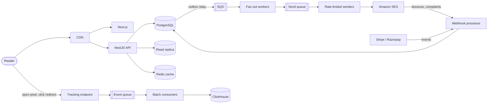
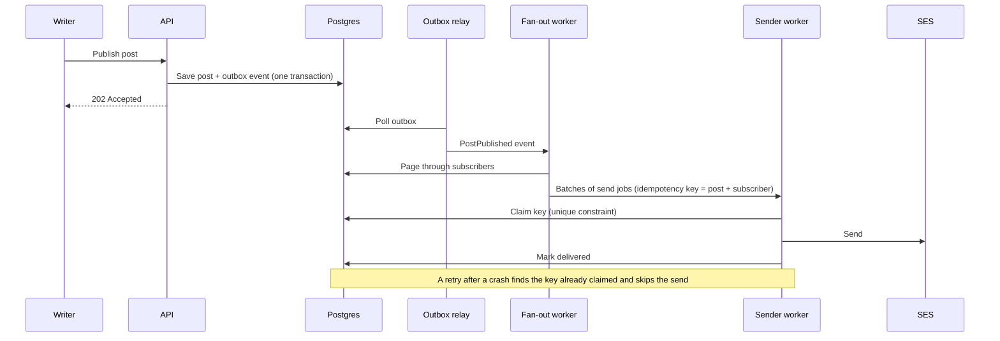

<div align="center">

# Vichaar

**Newsletter infrastructure built to survive its own success.**

A Substack-style publishing platform where the product is small and the engineering is not:
reliable email fan-out, a cache-first read path, and an event pipeline that never writes
a click to the primary database.

[](https://github.com/Dumbsham/inkwell/actions)


[Live demo](#) · [System design doc](docs/design.md) · [Decision records](docs/adr) · [Benchmarks](docs/benchmarks.md)

</div>

---

## Why this project exists

Anyone can build a CRUD app that stores posts and emails them in a `for` loop. That version works for 50 subscribers and collapses at 50,000. Inkwell is an exercise in building the version that keeps working: every design choice here is a response to a specific failure mode, documented in an ADR and covered by a test.

## The hard problems

| Problem | Why the obvious approach fails | What Inkwell does |
|---|---|---|
| **Send one post to 500k subscribers** | A loop in a request handler times out, double-sends on retry, and lets one large publication starve everyone else | Transactional outbox, batched fan-out, rate-limited senders with idempotency keys, per-publication fair scheduling, dead-letter queue |
| **Serve a write-once, read-millions workload** | Rendering from the database on every request melts under a traffic spike | Pages rendered to static HTML on publish, served CDN → Redis → read replica, with targeted invalidation on edit |
| **Track opens and clicks** | One database write per event takes down the primary | Edge endpoint → queue → batched ClickHouse inserts → pre-aggregated rollups |
| **Enforce a paywall** | Billing webhooks arrive late, twice, or out of order, so access drifts from reality | Idempotent handlers, event-version comparison, cached entitlements that fail closed |
| **Land in the inbox** | Bounces and spam complaints silently destroy sender reputation | SPF/DKIM/DMARC, bounce and complaint webhooks feeding a suppression list, per-domain warm-up |

## Architecture



Vichaar is a **modular monolith** with separately scaled worker processes. A service is only split out when scaling or failure isolation demands it ([ADR-001](docs/adr/001-modular-monolith.md)).

### How a post gets delivered



The outbox guarantees a post is never saved without its send event being recorded. The unique idempotency key guarantees a retry never produces a second email. Both properties are verified by the [chaos suite](#failure-testing).

## Design targets

These are the numbers the system is designed and tested against. Each one is checked by a named script, and measured results are published in [docs/benchmarks.md](docs/benchmarks.md).

| Target | Value | Verified by |
|---|---|---|
| Subscribers (platform) | 1,000,000 | `loadtests/seed.ts` |
| Largest single send | 500,000 recipients | `loadtests/send-500k.js` |
| Sustained send rate | 1,000 emails/sec (500k in about 8.3 min) | `loadtests/send-500k.js` |
| Post page read, CDN hit | p95 under 100 ms | `loadtests/read-path.js` |
| Post page read, cache miss | p95 under 300 ms | `loadtests/read-path.js` |
| Duplicate emails after a worker is killed mid-send | 0 | `chaos/kill-sender.test.ts` |
| Duplicate state change after webhook replay | 0 | `chaos/webhook-replay.test.ts` |

Derivations and assumptions are in [docs/design.md](docs/design.md#capacity-estimation).

## Features

**Writers:** publications on subdomains and custom domains with automatic TLS, rich-text editor, scheduled publishing, free and paid tiers, paywalled posts, analytics for opens, clicks, growth and paid conversion.

**Readers:** double opt-in, one-click unsubscribe, read on the web or in the inbox, one place to manage subscriptions and billing.

**Platform:** strict per-publication tenant isolation, suppression lists, structured logs, metrics, traces, and alerting.

## Tech stack

| Layer | Choice |
|---|---|
| Language | TypeScript (strict) end to end |
| Frontend | Next.js (App Router), Tailwind CSS |
| API | NestJS, Zod validation |
| Database | PostgreSQL with Drizzle ORM, one read replica |
| Cache | Redis (cache and rate limits only, never durable state) |
| Queues | Amazon SQS with dead-letter queues |
| Analytics | ClickHouse |
| Email | Amazon SES |
| Payments | Stripe (test mode) with a Razorpay adapter |
| Infra | Docker, Terraform, AWS (ECS, RDS, S3, CloudFront) |
| Observability | OpenTelemetry, Prometheus, Grafana, pino |
| Testing | Vitest, Playwright, k6 |
| Tooling | pnpm workspaces, Turborepo, GitHub Actions |

## Quick start

**Requirements:** Node.js 20+, pnpm 9+, Docker.

```bash
git clone https://github.com/<your-username>/inkwell.git
cd inkwell

pnpm install
cp .env.example .env
pnpm stack:up        # Postgres, Redis, LocalStack (SQS), ClickHouse, Mailpit
pnpm db:migrate
pnpm db:seed
pnpm dev             # web on :3000, API on :4000, workers
```

Outbound email is captured by Mailpit at `http://localhost:8025`, so nothing ever reaches a real inbox in development.

```bash
pnpm test            # unit and integration tests (real Postgres and Redis)
pnpm lint            # eslint, prettier, tsc --noEmit
pnpm loadtest        # k6 scenarios
pnpm chaos           # failure-injection suite
```

## Failure testing

Resilience is demonstrated, not claimed. `pnpm chaos` covers:

- Killing a sender worker mid-send: no duplicate and no lost emails
- Replaying the same billing webhook repeatedly and out of order
- Redis outage: reads fall back to the replica and the paywall fails closed
- SES throttling: backoff engages and the queue drains with no data loss
- Consumer lag: alerts fire before readers notice anything

## Repository layout

```
inkwell/
├── apps/
│   ├── api/                 NestJS modular monolith
│   │   └── src/modules/     auth, publications, posts, subscriptions,
│   │                        billing, delivery, analytics
│   ├── workers/             outbox relay, fan-out, sender, webhooks, analytics
│   └── web/                 Next.js frontend
├── packages/
│   ├── db/                  Drizzle schema and migrations
│   ├── queue/               typed SQS producers and consumers
│   └── shared/              Zod schemas and shared types
├── infra/                   Terraform
├── loadtests/               k6 scenarios
├── chaos/                   failure-injection tests
├── docs/                    design.md, benchmarks.md, runbook.md, adr/
└── AGENTS.md
```

## Documentation

- [System design](docs/design.md): requirements, capacity math, data model, APIs, failure analysis
- [Decision records](docs/adr): each major tradeoff with the alternatives that were rejected
- [Benchmarks](docs/benchmarks.md): methodology, hardware, raw output
- [Runbook](docs/runbook.md): dashboards, alerts, incident steps

## Roadmap

- [ ] Auth, publications, editor, public post pages
- [ ] Subscribers, double opt-in, outbox and queued delivery
- [ ] Read-path caching, CDN, and load tests
- [ ] Paid subscriptions and paywall
- [ ] Open and click tracking pipeline with analytics dashboard
- [ ] Custom domains with automatic TLS
- [ ] Chaos suite and published benchmarks
- [ ] Search and similar-post recommendations

## Contributing

Read [AGENTS.md](AGENTS.md) for conventions. `pnpm lint` and `pnpm test` must pass before opening a pull request.

## License

MIT. See [LICENSE](LICENSE).
