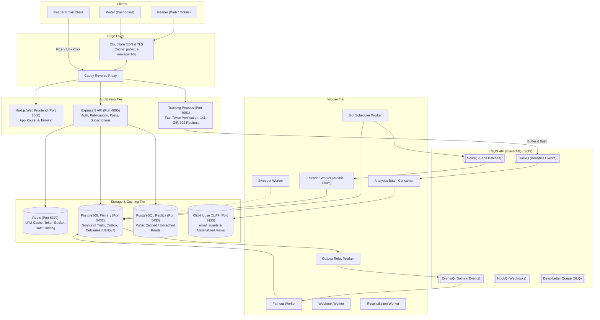

# Implementation Plan: Vichaar Newsletter Platform

## Goal Description
Build **Vichaar**, a production-grade, observable, scalable newsletter platform for Indian writers in TypeScript and Express 5, designed to run cleanly on a free-tier budget (2 vCPU, 12 GB RAM) and scale reliably to 500k-recipient sends.

The architecture implements:
- A **modular monolith** with separate worker processes and a dedicated tracking process (`apps/api`, `apps/tracking`, `apps/workers`).
- **PostgreSQL** as the single source of truth (Drizzle ORM) with monthly partitioning on `post_deliveries` (including a `DEFAULT` partition and maintenance utility).
- **Application-generated UUIDv7** across all entities for time-ordered, B-tree clustered primary keys.
- **Transactional outbox** ensuring state changes and domain events commit atomically.
- **Queue behind SQS API** (ElasticMQ in dev/demo, SQS in production blueprint).
- **At-most-once email delivery** with atomic claims (`queued` to `sending`, updating `updated_at = now()`) and `unknown_outcome` failure tagging (ADR-009).
- **Slot scheduling** across timezones with optional `sendImmediately: boolean` override, backpressure, and fair multi-tenant round-robin dispatch.
- **Dedicated tracking process & ClickHouse analytics** for high-volume open/click event ingestion that never touches PostgreSQL and never blocks or degrades the main API.
- **Paywall with fail-closed semantics**, cached in Redis with PostgreSQL fallback, resilient to out-of-order webhooks and repaired by an hourly reconciliation job.
- **Layered caching** for public posts with CDN and Redis, ensuring paid content never enters shared caches.
- **Delight features**: Indian language typography (Devanagari, Tamil), quote card generation with Satori/resvg, and exactly-once milestones.
- **Rigorous quality and security**: ESLint flat config with cross-module import boundary enforcement, CI with secret scanning and dependency audit from day one, and automated chaos injection suites located right next to their features.

---

## Decided Architecture Standards

1. **ID Type**: Application-generated **UUIDv7** (`uuidv7`) across all tables. Time-ordered, 128-bit, B-tree index friendly with zero random page-splits.
2. **"Publish Now" Slot Override**: `POST /publications/:pubId/posts/:postId/publish` supports optional `sendImmediately: boolean`. When `true`, `send_at` is set directly to `now()`, bypassing slot deferrals so it sends on the next scheduler tick. When `false`/omitted, slot scheduling determines `send_at`.
3. **Partition Safety**: `post_deliveries` partitioned monthly by `send_month`. A partition maintenance utility pre-creates the next 3 months, provisions a `DEFAULT` partition (`post_deliveries_default`), and runs a startup check/alert so a missing partition can never fail fan-out batch inserts.
4. **Session Storage & Hashing**: Stateful session tokens stored in a PostgreSQL `sessions` table with `HttpOnly`, `Secure`, `SameSite=Lax` cookies, protected by `argon2` password hashing.
5. **Process Isolation for Tracking**: Tracking endpoints (`/t/o/:token.gif` and `/t/c/:token`) run as an independent Express process (`apps/tracking` or dedicated entrypoint `apps/api/src/tracking-server.ts`) with identical shared packages, eliminating the risk of open/click traffic spikes degrading main API responsiveness.
6. **Linting Standards**: ESLint flat config (`eslint.config.js`) enforcing strict module boundaries (cross-module imports only allowed via public `index.ts`), accompanied by a dedicated test fixture proving boundary rule violations fail the build.
7. **CI & Threat Mitigations from Day 1**: CI (`.github/workflows/ci.yml`) is implemented in Phase 1A, running `pnpm lint`, `pnpm test`, secret scanning (`gitleaks`), and `pnpm audit --prod` (addressing Threat #13 in `threat-model.md`).

---

## System Architecture



---

## Phased Roadmap & Proposed Changes

---

### Phase 1A: Workspace Foundation, Infrastructure, Baseline Migration & CI
Establish the monorepo workspace, Docker Compose local dependencies, ESLint flat config with cross-module import enforcement and test fixture, database client baseline with UUIDv7 support and partition maintenance utility, Express 5 skeleton with health endpoints, and automated CI with security scanning.

#### 1A.1 Root Monorepo Configuration
- [NEW] `pnpm-workspace.yaml`: Defining `packages/*` and `apps/*`.
- [NEW] `package.json`: Workspace-level scripts (`pnpm stack:up`, `pnpm db:migrate`, `pnpm db:seed`, `pnpm dev`, `pnpm test`, `pnpm lint`, `pnpm loadtest`, `pnpm chaos`).
- [NEW] `turbo.json`: Turborepo pipeline caching for build, test, lint.
- [NEW] `tsconfig.base.json`: Strict TypeScript compiler options with `noUncheckedIndexedAccess: true`.
- [NEW] `eslint.config.js`: ESLint flat config with boundaries/import rules enforcing that modules inside `apps/api/src/modules/` only import other modules through their public `index.ts`.
- [NEW] `fixtures/boundary-violation-fixture/`: Test fixture with an illegal cross-module internal import to prove via an automated test that the boundary lint rule fails when violated.
- [NEW] `.prettierrc`: Consistent formatting standards.
- [NEW] `.env.example`: Complete environment variable declarations with local defaults.

#### 1A.2 Database Baseline & Partition Maintenance Utility (`packages/db`)
- [NEW] `packages/db/package.json`, `tsconfig.json`, `drizzle.config.ts`.
- [NEW] `packages/db/src/id.ts`: UUIDv7 generator utility function (`uuidv7`).
- [NEW] `packages/db/src/client.ts`: Drizzle PostgreSQL client factory with read-write primary and read-replica support.
- [NEW] `packages/db/src/schema/baseline.ts`: Initial baseline table (`_schema_version` / health check) to verify migration pipeline.
- [NEW] `packages/db/src/partition-manager.ts`: Partition maintenance utility:
  - Pre-creates partitions for current and next 3 months (e.g., `post_deliveries_2026_10`).
  - Provisions a `DEFAULT` partition (`post_deliveries_default`) as a defensive safety net.
  - Startup check / alert function ensuring the upcoming partition exists before fan-out runs.
- [NEW] `packages/db/src/migrate.ts`: Automated Drizzle migration runner executing schema migrations and partition provisioning.

#### 1A.3 Local Infrastructure (`infra/compose`)
- [NEW] `infra/compose/docker-compose.yml`:
  - `postgres`: Primary database on port 5432 with memory limit 2.0 GB.
  - `postgres-replica`: Read replica on port 5433 with memory limit 0.75 GB.
  - `redis`: Redis cache and rate limiter on port 6379 with memory limit 0.6 GB (`maxmemory 512mb`, `allkeys-lru`).
  - `elasticmq`: SQS-compatible queue on port 9324/9325 with memory limit 0.5 GB.
  - `clickhouse`: Analytics engine on port 8123/9000 with memory limit 2.0 GB.
  - `mailpit`: Local SMTP and web inbox on port 1025/8025.
  - `caddy`: Reverse proxy on port 80/443.
- [NEW] `infra/compose/elasticmq.conf`: Pre-configured queues (`vichaar-events`, `vichaar-sends`, `vichaar-hooks`, `vichaar-tracks`, and DLQs).
- [NEW] `infra/compose/clickhouse-init.sql`: Initial ClickHouse table schemas.

#### 1A.4 Express 5 API Skeleton & Health Endpoints (`apps/api`)
- [NEW] `apps/api/package.json`, `tsconfig.json`
- [NEW] `apps/api/src/server.ts`: Express 5 app with middleware chain (correlation ID, pino logger, helmet, CORS, JSON parser, error handler).
- [NEW] `apps/api/src/shared/logger.ts`: Pino logger with PII redaction.
- [NEW] `apps/api/src/modules/health/`: `GET /healthz`, `GET /readyz` verifying database connectivity.
- [NEW] `apps/api/src/index.ts`: API entrypoint listening on port 4000.

#### 1A.5 Continuous Integration & Security Scanning (`.github/workflows/ci.yml`)
- [NEW] `.github/workflows/ci.yml`:
  - Runs on push and pull request.
  - Installs dependencies using `pnpm install --frozen-lockfile`.
  - Runs `pnpm lint` (validates TypeScript types and ESLint boundary rules).
  - Runs `pnpm test` (unit tests and boundary rule verification).
  - Runs secret scanning (e.g. `gitleaks` action) to prevent credential leaks (Threat #13).
  - Runs `pnpm audit --prod` to catch vulnerable dependencies (Threat #13).

---

### Phase 1B: Domain Foundation (Auth, Tenant Scoping, Publications & Posts)
Implement the core domain models, Postgres-backed session authentication with argon2, tenant isolation, publication management, post drafts with optimistic locking, allow-list HTML sanitization, and the publish endpoint supporting `sendImmediately`.

#### 1B.1 Shared Package (`packages/shared`)
- [NEW] `packages/shared/package.json`, `tsconfig.json`
- [NEW] `packages/shared/src/errors.ts`: Typed domain errors (`NotFoundError`, `ForbiddenError`, `ValidationError`, `ConflictError`, `VersionConflictError`, `SubscriptionRequiredError`).
- [NEW] `packages/shared/src/clock.ts`: `Clock` interface and `SystemClock` / `FakeClock`.
- [NEW] `packages/shared/src/schemas/`: Zod schemas for auth, publications, posts, and pagination cursors.

#### 1B.2 Core Database Schema (`packages/db`)
- [NEW] `packages/db/src/schema/users.ts`: `users` table with UUIDv7 PK, citext email, argon2 password_hash, timezone.
- [NEW] `packages/db/src/schema/sessions.ts`: `sessions` table (UUIDv7, session_token_hash, user_id, expires_at, created_at, last_seen_at).
- [NEW] `packages/db/src/schema/publications.ts`: `publications` table with owner_id, subdomain, monthly_price_paise, sending_status, daily_send_limit, subscriber_count.
- [NEW] `packages/db/src/schema/posts.ts`: `posts` table with publication_id, slug, status, scheduled_for, published_at, version.
- [NEW] `packages/db/src/schema/post_contents.ts`: `post_contents` table with jsonb body, `html_preview`, `html_full`.
- [NEW] `packages/db/src/schema/outbox_events.ts`: `(id bigserial, event_type, payload, created_at, published_at)`.

#### 1B.3 Auth Module (`apps/api/src/modules/auth/`)
- Password hashing using `argon2`.
- `POST /auth/signup`, `POST /auth/login`, `POST /auth/logout`.
- Session cookies (`HttpOnly`, `Secure`, `SameSite=Lax`) with session state verified in PostgreSQL.

#### 1B.4 Tenant Resolution & Scoping Middleware
- Middleware resolving tenant publication from URL (`/publications/:pubId/...` or `/public/:subdomain/...`).
- Hard rule: all repository queries require `publicationId`. Unmatched tenant returns 404.

#### 1B.5 Publications & Posts Modules (`apps/api/src/modules/`)
- Publications management (`POST`, `GET /publications`, `GET`, `PATCH /publications/:pubId`).
- Posts management:
  - Draft creation, autosave with optimistic locking (requires matching `version`, else returns 409 `VERSION_CONFLICT`).
  - Body sanitization: allow-list HTML sanitizer (`sanitize-html` stripping scripts, event handlers, and `javascript:` URLs).
  - Publish endpoint: `POST /publications/:pubId/posts/:postId/publish` accepting `{ sendImmediately?: boolean }`. Executes atomic publish transaction: updates post status, writes sanitized HTML, tracks links, updates writing streak, and emits `PostPublished` outbox event with `sendImmediately` flag.
- Public post previews: `GET /public/:subdomain/posts/:slug` (cacheable previews with ETag from version).

---

### Phase 2: Delivery Pipeline, Slot Scheduling & Sender Chaos
Implement double opt-in subscriptions with a bare-bones UI for early testing, full partitioned `post_deliveries` schema, outbox relay, fan-out, slot scheduler, sender worker with atomic claims, sweeper, and the `kill-sender` chaos test.

#### 2.1 Subscription Management (`apps/api/src/modules/subscriptions/`)
- Double opt-in: `POST /public/:subdomain/subscribe` (always returns 202).
- Confirmation: `POST /subscriptions/confirm` (atomic update `pending -> active`, increments `subscriber_count`).
- Unsubscribe: `POST /unsubscribe/:token` (signed token).
- **Bare-bones Verification Page**: Lightweight static HTML page (`/subscribe-demo`) served by the API in Phase 2 allowing manual testing of subscribe and confirm flows before the Phase 8 Next.js frontend is built.

#### 2.2 Complete `post_deliveries` Partitioned Schema (`packages/db`)
- [NEW] `packages/db/src/schema/post_deliveries.ts`:
  - Partitioned monthly by `send_month`.
  - Composite PK: `(post_id, subscription_id, send_month)`.
  - Columns: `publication_id`, `send_at`, `status` (`pending`, `queued`, `sending`, `sent`, `failed`, `skipped`, `bounced`), `provider_message_id`, `attempts`, `last_error`, `sent_at`, `updated_at`.
  - Partial Index 1: `(send_at)` WHERE `status = 'pending'` (for slot scheduler).
  - Partial Index 2: `(status, updated_at)` WHERE `status IN ('queued', 'sending')` (for sweeper).
  - Provisioned with `DEFAULT` partition (`post_deliveries_default`).

#### 2.3 Queue & Workers Implementation (`packages/queue`, `apps/workers`)
- Typed producers and consumers for SQS API (`EventsQ`, `SendQ`).
- `outbox-relay.ts`: Polls `outbox_events` with `FOR UPDATE SKIP LOCKED`, pushes to `EventsQ`.
- `fanout.ts`: Consumes `PostPublished`, pages active subscribers in chunks of 1,000, evaluates suppression list, calls `computeSendAt(..., sendImmediately)`, inserts into `post_deliveries` (`status='pending', updated_at=now()`, `ON CONFLICT DO NOTHING`).
- `slot-scheduler.ts`: Evaluates due deliveries (`status='pending' AND send_at <= now()`), claims them `UPDATE post_deliveries SET status='queued', updated_at=now() WHERE ...`, enqueues batches to `SendQ`.
- `sender.ts`: Consumes `SendQ`:
  - **Atomic Claim (ADR-009):** `UPDATE post_deliveries SET status='sending', attempts=attempts+1, updated_at=now() WHERE (keys) AND status='queued' RETURNING ...`.
  - Pre-flight re-check: subscription active, address not suppressed, publication not paused.
  - Rate limiting via Redis token bucket.
  - Sends email via `EmailProvider` (`MailpitProvider`, `SESProvider`, `StubProvider`).
  - Batch records status setting `updated_at=now()`: `sent`, `queued` (throttle), `failed` (permanent), or `failed: unknown_outcome` (timeout).
- `sweeper.ts`:
  - Recovers rows stuck in `sending` > 10 min -> `failed: unknown_outcome`, `updated_at=now()`.
  - Recovers rows stuck in `queued` > 30 min past `send_at` -> `pending`, `updated_at=now()`.

#### 2.4 Feature-Linked Chaos Test: Kill-Sender (`chaos/kill-sender.test.ts`)
- [NEW] `chaos/kill-sender.test.ts`:
  - Triggers a batch send against the stub provider.
  - Emits `SIGKILL` to the sender process mid-batch.
  - Asserts zero duplicate emails were sent.
  - Asserts in-flight deliveries are transitioned to `failed` with `unknown_outcome` by the sweeper, proving ADR-009 correctness.

---

### Phase 3: Read Path, Layered Caching & Replica Support
Implement CDN headers, Redis cache with single-flight mutex stampede protection, paid content isolation, and read-replica routing.

- [NEW] `apps/api/src/shared/cache.ts`: Redis caching with single-flight mutex and TTL jitter.
- Post read routes:
  - Public post preview: `Cache-Control: public, s-maxage=60, stale-while-revalidate=300`, `ETag` from post `version`.
  - Paid post body: `GET /public/:subdomain/posts/:slug/full` -> `Cache-Control: private, no-store`, requires entitlement verification.
- Targeted cache invalidation upon post update or unpublish.
- Read-replica routing for public endpoints with automatic fallback to primary.
- [NEW] `loadtests/read-path.js`: k6 script testing cached read target (1,000 req/s, p95 < 100ms) and uncached reads (100 req/s, p95 < 300ms).

---

### Phase 4: Paid Subscriptions, Razorpay, Paywall & Webhook Chaos
Implement reader checkout, Razorpay webhooks, fail-closed paywall verification, hourly reconciliation, and the `webhook-replay` chaos test.

- [NEW] `apps/api/src/modules/billing/`:
  - `POST /public/:subdomain/checkout`: Creates Razorpay subscription, inserts `paid_subscriptions`.
  - `POST /webhooks/razorpay`: Verifies HMAC-SHA256 signature against raw request body, deduplicates into `webhook_events`, enqueues to `HookQ`, returns 200.
  - `GET /me/subscriptions`: Reader subscription status.
- [NEW] `apps/workers/src/webhook-processor.ts`: Consumes `HookQ`:
  - Transactional update on `paid_subscriptions` with `FOR UPDATE`.
  - Out-of-order rejection: Ignores payload if event timestamp is `<= last_event_at`.
  - Invalidates Redis entitlement cache for `(userId, publicationId)`.
- Entitlement Service (`isEntitled`):
  1. Check Redis cache (60s TTL).
  2. On miss / Redis outage: Query PostgreSQL `paid_subscriptions`.
  3. On PostgreSQL failure: Return **503 Try Again** (fail closed without wrongful 403).
- [NEW] `apps/workers/src/reconciliation.ts`: Hourly job fetching subscriptions from Razorpay with outdated `last_event_at`, repairing lost webhooks.
- [NEW] `chaos/webhook-replay.test.ts`:
  - Replays historical webhooks and out-of-order payment failure/success events.
  - Asserts entitlement state is never corrupted and reconciliation repairs dropped events.

---

### Phase 5: Dedicated Tracking Process & ClickHouse Analytics
Implement the standalone tracking process for opens and clicks, buffered message flushing, and ClickHouse OLAP rollups.

- **Dedicated Tracking Process (`apps/tracking` or `apps/api/src/tracking-server.ts`)**:
  - Standalone Express server on port 4001, completely isolated from main API.
  - `GET /t/o/:token.gif`: Open tracking pixel. Verifies signed HMAC token in memory, detects prefetch bots, buffers event, immediately serves 1x1 GIF with `Cache-Control: no-store`.
  - `GET /t/c/:token`: Click redirect. Verifies signed token, resolves URL from LRU cache/Redis/Postgres, buffers click event, responds immediately with HTTP 302 redirect. Analytics lag never blocks reader navigation.
  - Bounded in-memory ring buffer flushing to `TrackQ` every 200ms.
- [NEW] `apps/workers/src/analytics-consumer.ts`: Consumes `TrackQ` in batches (up to 1,000 events / 1s window), inserts into ClickHouse `email_events` table (`ReplacingMergeTree` keyed on `event_id`).
- ClickHouse Materialized Views: Pre-aggregated rollups by `(publication_id, post_id, date)`.
- Writer Analytics API: `GET /publications/:pubId/stats` querying ClickHouse rollups (never touches Postgres).
- [NEW] `loadtests/events.js`: k6 script verifying 1,000 events/sec ingestion rate.

---

### Phase 6: Delight Features (Typography, Quote Cards, Milestones, Streaks)
Implement language support, Satori quote cards, and streak/milestone tracking.

- Typography: Language tag support (`hi`, `ta`, `en`, etc.) with Noto Sans Devanagari and Tamil font rendering.
- Quote Cards (`POST /public/:subdomain/posts/:slug/quote-cards`):
  - Normalized quote validation (Unicode NFC, collapsed whitespace, <= 200 chars).
  - Substring check against allowed post text (prevents paid content leaks).
  - Satori SVG rendering + `@resvg/resvg-js` PNG generation (max 2 concurrent renders).
  - Deterministic hash caching (`post_id + quote_hash`).
- Milestones Worker: Consumes `SubscriptionConfirmed` events; inserts into `milestones` table with `ON CONFLICT DO NOTHING`; triggers writer notification only when a new row is inserted.
- Streaks: Evaluated atomically inside publish transaction based on IST ISO calendar week.

---

### Phase 7: Hardening, Observability & Remaining Chaos Suite
Implement OpenTelemetry, Prometheus metrics, structured logs, and remaining infrastructure failure tests.

- Observability:
  - Prometheus metrics (`/metrics`): queue depth, throughput, error rates, CPU milliseconds per email, unknown outcome counter, cache hit ratios.
  - Pino structured JSON logs with correlation ID propagation.
  - OpenTelemetry tracing spans around external calls (database, Redis, queues, email, payments).
- Remaining Chaos Suite (`chaos/`):
  - [NEW] `chaos/redis-failure.test.ts`: Stops Redis container; verifies paywall falls back to PostgreSQL and reads continue.
  - [NEW] `chaos/clickhouse-storm.test.ts`: Halts ClickHouse container during 1,000 clicks/sec burst; verifies clicks continue redirecting and backlog drains upon recovery.
- Load Tests (`loadtests/`):
  - `loadtests/send-500k.js`: 500,000 email fan-out benchmark against stub provider aiming for 1,000 emails/s.
  - `loadtests/slots.js`: Validates 99% of slot-scheduled emails start within 5 minutes of slot time.

---

### Phase 8: Next.js Frontend & Production Deployment Blueprint
Implement the full Next.js web application and the production Terraform blueprint.

- Next.js Web App (`apps/web`):
  - App Router, Tailwind CSS.
  - Reader views: publication landing page, post view, slot selector, double opt-in confirmation, paywall preview with Razorpay checkout button.
  - Writer views: dashboard, subscriber list, analytics charts, post editor (Tiptap with Indian language support), scheduled publish settings, quote card generator preview.
- Deployment Blueprint (`infra/terraform`):
  - Terraform plan for AWS (ECS Fargate, RDS PostgreSQL Multi-AZ with read replica, ElastiCache Redis, SQS with DLQs, S3 for images, CloudFront CDN).
  - Cost modeling via Infracost.
- Automated daily backup script (`pg_dump` to object storage with test restore runbook).

---

## Verification Plan

### Automated Tests
1. **Linting and Type Checks:**
   ```bash
   pnpm lint
   ```
   Validates boundary rules via ESLint flat config (`eslint.config.js`), TypeScript strictness (`noUncheckedIndexedAccess`), and Prettier formatting.
2. **Boundary Lint Rule Fixture Test:**
   ```bash
   pnpm test:boundary-fixture
   ```
   Runs ESLint against `fixtures/boundary-violation-fixture` and asserts that illegal cross-module internal imports produce an ESLint error.
3. **Unit & Integration Tests:**
   ```bash
   pnpm test
   ```
   Runs Vitest integration tests against real Docker containers (PostgreSQL, Redis, ElasticMQ).
4. **Security Audits & Secret Scanning:**
   ```bash
   pnpm audit --prod
   gitleaks detect --source . -v
   ```
5. **Chaos Failure Injection:**
   ```bash
   pnpm test chaos/kill-sender.test.ts
   pnpm test chaos/webhook-replay.test.ts
   pnpm chaos
   ```
6. **Load & Performance Tests:**
   ```bash
   pnpm loadtest
   ```

### Manual Verification
1. **Health Endpoints (Phase 1A):**
   ```bash
   curl -i http://localhost:4000/healthz
   curl -i http://localhost:4000/readyz
   ```
2. **Double Opt-In Flow (Phase 2):**
   - Open `/subscribe-demo` bare-bones HTML page.
   - Enter email, select slot, verify 202 response.
   - Open Mailpit at `http://localhost:8025`, click confirmation link, verify subscription activates in PostgreSQL.
3. **End-to-End Publish & Delivery (Phase 2):**
   - Create post and publish with `sendImmediately: true`.
   - Verify outbox relay, fan-out, and sender delivery into Mailpit web UI.
