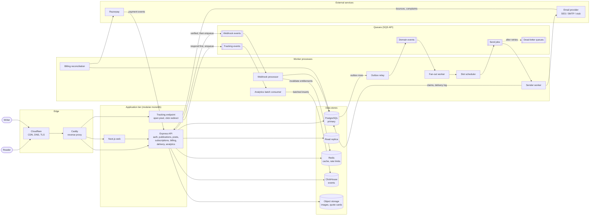
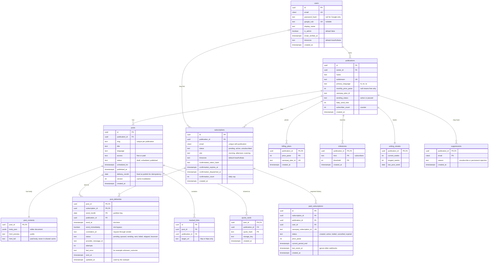

# Vichaar: System design

Status: draft v1, 2026-10-18.
Companion documents: [flows.md](flows.md), [threat-model.md](threat-model.md), [failure-analysis.md](failure-analysis.md), [adr/](adr).

## Overview

Vichaar is a newsletter platform for Indian writers. A writer publishes a post, and subscribers receive it by email and can read it on the web. Posts can be free or paid, priced in rupees, and written in any Indian language.

**Goals**
- Deliver one post to up to 500,000 subscribers reliably, without duplicates and without starving small publications.
- Serve posts from cache so a viral post does not touch the database.
- Keep the paywall correct even when payment events arrive late, twice, or out of order.
- Run the whole demo on one free-tier VM (2 vCPU, 12 GB RAM) while keeping the design production-shaped.

**Non-goals for v1**
Comments, podcasts and video, mobile apps, recommendations, multi-author teams, custom domains (v2), CSV subscriber import (stretch), a discovery page with a language filter, live send progress, tipping.

## Requirements

### Users
- **Writer:** creates a publication, writes and publishes posts, earns from paid subscribers.
- **Reader:** subscribes, reads on the web or in the inbox, pays for premium content. The same account can be both.
- **Admin:** monitors the system and handles abuse.

### Functional requirements

**Writer**
1. Sign up, log in, create a publication with a name and subdomain.
2. Write a post in a rich-text editor, save drafts, publish, or schedule.
3. Mark a post as free or paid-only.
4. Set one monthly price for the publication (suggested range ₹50-100).
5. See opens, clicks, subscriber growth and paid conversions.
6. Choose the language of each post.
7. See milestone celebrations (10, 100, 1,000 subscribers) and a weekly writing streak.

**Reader**
1. Subscribe with an email, confirmed by double opt-in.
2. Receive new posts by email, at the chosen delivery slot (morning, afternoon, evening) in the reader's timezone.
3. Read posts on the web. Paid posts show a preview and a paywall unless subscribed.
4. Pay in rupees through Razorpay, cancel, and unsubscribe in one click.
5. Select a line from a post and share it as an image card.

**System**
1. Fan out one published post to all subscribers by email.
2. Handle bounces and spam complaints by suppressing those addresses.
3. Track email opens and link clicks.
4. Process payment events (activate, renew, cancel, fail) and update access.
5. Schedule each subscriber's send for their slot.
6. Generate and cache quote-card images.
7. Fire each milestone exactly once.

### Non-functional requirements

| Area | Requirement |
|---|---|
| Scale | 10,000 publications, 1M subscriptions, largest publication 500k |
| Send throughput | 500k-recipient post delivered in under 10 minutes |
| Read latency | Post page p95 under 100 ms cached, under 300 ms uncached |
| Correctness | No duplicate emails, even when workers crash or retry |
| Availability | Reading stays up even if email or billing is down |
| Consistency | Strong for subscribers, billing and access. Eventual is fine for analytics |
| Security | A tenant can never see another tenant's data. Webhooks are signature-verified |
| Privacy | Subscriber emails are never exposed or logged in plain text |
| Observability | Metrics, logs and traces for every flow, with alerts on queue lag and failures |
| Scheduled send | 99% of emails begin sending within 5 minutes of their slot |
| Quote card | Uncached p95 under 1 second, cached served from the CDN |
| Language | Devanagari and Tamil render correctly on the web and in email |
| Milestones | Each milestone fires exactly once |
| Cost | Total spend of about ₹500-800 over 6 months |

### Constraints and assumptions
- One builder, about 8-10 weeks. TypeScript end to end.
- India-first: prices in rupees, Razorpay payments, IST as the default timezone.
- Email goes through a provider (SES), so no mail servers are run. SES stays in sandbox for the demo.
- Payments run in test mode.
- Demo scale is simulated with seeded data and load tests against a stubbed email provider.
- Writers must confirm they have consent for any address they add (India's DPDP Act).

## Current implementation (Phase 6)

The local demo API now supports signup, login and logout with Argon2id password hashes and hashed PostgreSQL sessions. Auth requests use a Redis token bucket with a smaller local fallback when Redis is unavailable. It also supports tenant-scoped publication and draft post endpoints; version-checked autosave; and a publish transaction that writes sanitized HTML, tracked link rows, a writing streak, and one `PostPublished` outbox event. A public endpoint returns only the preview of a published post. The full body of a paid post is never returned by that endpoint.

Phase 2 adds double opt-in subscriptions, signed confirmation and unsubscribe links, suppression, reader delivery preferences, a monthly partitioned delivery ledger, and five separately run worker roles. The outbox relay publishes typed SQS messages; fan-out pages active subscribers in batches of 1,000; the scheduler uses a durable round-robin publication cursor, daily send budgets, and queue-depth backpressure; the sender claims up to 100 delivery rows in one statement before any provider call. A stale `sending` row becomes `failed: unknown_outcome` and is never automatically sent again. Explicit temporary SMTP rejections can return to `pending` with bounded exponential backoff and jitter. The sweeper also recovers stale `queued` rows and purges published outbox records older than seven days.

Phase 3 added Redis public-preview caching, narrow invalidation, CDN-compatible headers, and a streaming read replica. Phase 4 adds test-mode Razorpay checkout, a signed webhook inbox, a hooks worker, hourly reconciliation, and database-backed paid access with a 60-second Redis cache. Phase 5 adds an isolated tracking listener on port 4001, bounded in-memory buffering to TrackQ, a ClickHouse batch consumer and materialized rollups, and publication-scoped writer statistics. Tests use a stub Razorpay provider; real test-mode checkout requires operator-supplied test credentials. The local demo runs API, tracking, and worker Node processes against Compose dependencies. The SMTP path targets Mailpit locally; tests use a stub provider. SES is restricted to production and configured verified sandbox recipients. The Next.js editor, external CDN deployment, containerized API/workers, and Terraform deployment remain future phases. No live demo or production deployment is claimed.

Phase 6 adds Unicode-normalized quote validation against free post text or the paid preview unless the caller is entitled. Satori and resvg render stable PNG cards using bundled Noto Sans fonts for Latin, Devanagari, and Tamil. The API caps active renders at two; PostgreSQL stores unique card metadata and the demo writes images under `QUOTE_CARD_DIR`. The fanout worker consumes `PostUnpublished` to delete card files and metadata. Confirmation now emits `SubscriptionConfirmed` transactionally; the worker inserts 10, 100, and 1,000 subscriber milestones once and sends the writer an at-most-once notification. A writer-only endpoint returns milestones and the existing IST weekly streak. Full web typography and card creation controls remain in the Next.js phase. See [ADR-014](adr/014_QuoteCardsAndMilestones.md).

For deployments behind a reverse proxy, set `TRUST_PROXY` to that proxy's specific address or CIDR so `req.ip` used by rate limiting identifies the reader. Direct API access leaves proxy trust disabled. This must match the actual Caddy/network setup before enabling it.

## Capacity estimation

Every number is an assumption and can be changed. One day is 86,400 seconds, so per-day divided by 86,400 gives the per-second average.

### Assumptions

| Item | Value |
|---|---|
| Publications | 10,000 |
| Subscriptions | 1,000,000 (largest publication 500,000) |
| Posts per publication | 1 per week |
| Paid conversion | 5% (50,000 paying) |
| Open rate | 40%, about 1.5 opens per opener |
| Click rate | 5%, about 1.5 clicks per clicker |
| Web readers | 10% of subscribers per day, 3 page views each |

### Results

**Signups and billing.** 1M subscriptions per year is about 2,740 per day, or 0.03 per second. A burst of 5,000 signups in 10 minutes is about 8 per second. 50,000 paid subscribers renewing monthly is about 1,700 per day, or 0.02 per second. These are tiny, so correctness matters here, not speed.

**Sends.** 10,000 posts times 100 subscribers is 1M emails per week, about 143,000 per day, or 1.65 per second on average. Worst case: the 500k publication publishes and 60% choose the morning slot, so 300,000 emails fall into one 15-minute bucket (900 seconds), about 333 per second, plus about 100 per second from other publications, about 430 per second. At 1,000 per second, 500,000 emails take 500 seconds, about 8.3 minutes. **Design target: 1,000 emails per second** (2.3x headroom). Peak over average is about 600x, which justifies a queue.

Each email needs two database writes (claim, then mark), so 2,000 writes per second at full rate. Batching 100 rows per statement reduces this to about 20 statements per second. At about 40 KB per email, 1,000 per second is about 40 MB/s to the provider. Real provider quotas limit actual throughput, which is why load tests use a stub.

**Page reads.** 10% of 1M is 100,000 readers times 3 pages, 300,000 views per day, about 3.5 per second. Normal peak at 10x is about 35 per second. A viral post (50,000 views in 10 minutes) is about 83 per second. **Design targets: 1,000 per second cached, 100 per second uncached.** With a 95% hit ratio, 1,000 requests per second leaves about 50 per second for the origin.

**Tracking events.** About 0.7 events per email (0.6 opens, 0.075 clicks). That is 700,000 per week, about 100,000 per day, 1.2 per second on average. Some mail clients preload the tracking pixel on delivery, so opens spike with the send: at 1,000 sends per second, 40-50% preloading gives 400-500 events per second. **Design target: 1,000 events per second**, inserted in batches (about 1 insert per second).

**Storage per year (full scale).**

| Data | Calculation | Size |
|---|---|---|
| Posts | 520,000 x 30 KB | about 16 GB |
| Post images (object storage) | 520,000 x 200 KB | about 100 GB |
| Subscribers with indexes | 1M x 500 B | about 0.5 GB |
| Delivery log | 52M rows x 150 B | about 7.8 GB |
| Tracking events (ClickHouse) | 36.4M x 100 B, about 8x compression | about 0.5 GB |
| Redis | capped by `maxmemory` | 512 MB (RAM) |

Postgres total is about 25 GB per year. The demo seeds far less.

### What the numbers decide
1. A queue is justified by the 600x gap between peak and average sends.
2. One Postgres is enough if send-state writes are batched and the delivery log is partitioned monthly (about 90 days hot).
3. A CDN and cache are justified: reads are about 95% cacheable and a viral post is about 12x under the target.
4. Event ingestion must be batched because opens spike together with sends.
5. ClickHouse is partly an engineering choice: 36M events per year would also fit in partitioned Postgres. It isolates analytics from the primary and suits rollup queries. If the stack is too heavy for the VM, fall back to partitioned Postgres behind the same interface ([ADR-006](adr/006-clickhouse-for-events.md)).

### Summary

| Metric | Average | Design target |
|---|---|---|
| Emails sent | 1.65/s | 1,000/s |
| Database statements on the send path | n/a | about 20/s (batched) |
| Page reads | 3.5/s | 1,000/s cached, 100/s uncached |
| Tracking events | 1.2/s | 1,000/s |
| Signups | 0.03/s | 10/s |
| Postgres size | n/a | about 25 GB per year |

## Resource budget

Target machine: 2 vCPU, 12 GB RAM, running every service. These are starting limits, to be adjusted after measuring with `docker stats` during load tests. Every container has a memory limit so a runaway container is killed by itself instead of the host killing Postgres.

| Service | Memory limit | Note |
|---|---|---|
| OS, Docker, Caddy, exporters | 0.8 GB | fixed overhead |
| Postgres primary | 2.0 GB | `shared_buffers` about 512 MB, `max_connections` 100 |
| Postgres replica | 0.75 GB | for the read-path demo, stop during chaos runs if tight |
| Redis | 0.6 GB | `maxmemory 512mb`, `allkeys-lru` |
| ElasticMQ | 0.5 GB | JVM heap about 256 MB |
| ClickHouse | 2.0 GB | `max_server_memory_usage` below the container limit |
| API (Express) | 0.5 GB | quote-card renders limited to 2 at a time |
| Tracking listener | 0.2 GB | bounded 1,000-event memory buffer; target not yet measured |
| Workers (relay, fan-out, scheduler, sender, webhooks, analytics) | 1.2 GB | about 300 MB each |
| Web (Next.js standalone) | 0.5 GB | |
| Prometheus, Grafana, OpenTelemetry collector | 0.8 GB | |
| **Total** | **9.85 GB** | about 2.15 GB left for page cache and spikes |

A 4 GB swapfile is a safety net, not working memory. If swap is used in normal operation the budget is wrong. Under pressure, observability and analytics are sacrificed first, then the replica. The primary, API and sender are protected.

**CPU is the likelier constraint.** Rough peak shares of 2 vCPU: Postgres 0.5-0.7, sender and fan-out 0.5-0.8, API and web 0.3-0.5, analytics and observability 0.3-0.4. Peaks overlap, so priorities apply: the sender is capped at `cpus: 1.0` in the future container deployment, the API and web get a higher `cpu_shares`, and sender concurrency is capped. The current API opens at most 10 primary and 10 replica pool connections; each of the eight worker roles opens at most 3 primary connections, and the tracking listener opens at most 2, for a total upper bound of 46 connections. The local worker supervisor is not container-limited yet; the worker and tracking budgets remain to be measured under load before deployment.

`sustainable sends per second = vCPUs available to the send path / CPU-seconds per email`. Measure CPU milliseconds per email early (Phase 2). If the measured value does not support 1,000 per second on this VM, publish the measured number as the target instead of hiding it. Load generators (k6) run from a separate machine.

## Architecture



### Principles
- **Only Postgres is durable truth.** Redis and ClickHouse can be rebuilt. Queues carry work, not truth.
- **Webhooks are verified, stored, enqueued, then acknowledged,** so a slow handler never makes a sender retry.
- **The tracking path never depends on ClickHouse.** A valid click redirects when its stored target can be resolved from PostgreSQL.
- **The database holds the schedule.** The queue only contains work that is due.
- **Providers sit behind interfaces** (email, queue, object storage), so the same code runs in the demo and the production blueprint.

### Code structure
Express 5, layered `route -> service -> repository`, one folder per module with a single public `index.ts` enforced by a lint rule, no Express types in services, one composition root shared by the API and workers, Zod at every boundary ([ADR-002](adr/002-express-framework.md)).

## Data model

Conventions: UUID ids (time-ordered UUIDv7 proposed), timestamps in UTC (`timestamptz`), money as integer paise, emails as case-insensitive `citext`, every tenant table carries `publication_id`.



### Unique constraints
- `subscriptions (publication_id, email)`
- `posts (publication_id, slug)`
- `paid_subscriptions (razorpay_subscription_id)` and a partial unique index on `(publication_id, subscription_id)` for open rows
- `milestones (publication_id, kind, threshold)`, which makes a milestone fire exactly once
- `quote_cards (post_id, quote_hash)`
- `suppressions (publication_id, email)`; platform-wide suppression is planned with email-event ingestion
- `post_deliveries (post_id, subscription_id, send_month)` as the primary key

### Key indexes
- `subscriptions (publication_id, id)` partial where `status = 'active'` for keyset fan-out
- `posts (publication_id, status, published_at DESC, id DESC)` for keyset-paginated lists
- `post_deliveries (send_at)` partial, where `status = 'pending'`, for the scheduler
- `post_deliveries (status, updated_at)` partial, where `status IN ('queued','sending')`, for the sweeper
- `post_deliveries (publication_id, updated_at)` partial for daily send budgets
- `post_deliveries (publication_id, subscription_id, post_id, send_month)` partial for pending preference changes
- `outbox_events (id)` partial, where `published_at IS NULL`

### Tables outside the diagram (no foreign keys, by design)
- **outbox_events:** `id bigserial`, `event_type`, `payload jsonb`, `created_at`, `published_at` (null until relayed).
- **scheduler_state:** one durable cursor row for round-robin publication selection. Locking this row serializes scheduler ticks without a Redis lease.
- **webhook_events:** `id`, `provider`, `provider_event_id`, `type`, `payload jsonb`, `received_at`, `processed_at`, `status`. Unique on `(provider, provider_event_id)`.
- **sessions:** `id` (hash of the session token), `user_id`, `created_at`, `expires_at`, `last_seen_at`.
- **auth_tokens:** `id`, `user_id`, `purpose` (verify email, reset password), `token_hash`, `expires_at`, `used_at`.

### Notes
- **Partitioning:** `post_deliveries` is partitioned monthly by `send_month`, copied from the post's immutable `delivery_month` fixed in the publish transaction. It is identical for every recipient of a post and never changes when slot or timezone changes. This keeps `(post_id, subscription_id, send_month)` a true idempotency key under fan-out replay. Partition maintenance pre-creates the current and next three months and keeps `post_deliveries_default` as a safety net. If a missing month accumulated rows in the default partition, maintenance moves those rows under an exclusive parent-table lock before attaching the month. Workers verify current and next-month partitions at startup, so an overdue partition stops delivery work until maintenance completes.
- **Why `post_contents` is separate:** list queries never load large bodies, and the paid body is isolated so it cannot leak through a "select everything" query.
- **Why `subscriptions` is separate from `users`:** a free reader needs only a confirmed email. Account linking is a later phase.
- **Counters:** `subscriber_count` is updated in the same transaction as the status change, so there is no `COUNT(*)` on large tables.

### ClickHouse
`email_events`: `event_id`, `publication_id`, `post_id`, `subscription_id`, `link_id` (null for opens), `event_type` (open, click), `is_prefetch`, `occurred_at`. `ReplacingMergeTree` keyed on `event_id`, monthly partitions, rollups via materialized views. No raw email addresses and no IP addresses.

## API design

**Ground rules.** Base path `/api/v1`. JSON, camelCase, application-generated UUIDv7 IDs (time-ordered, index-friendly B-tree clustering), UTC timestamps, money in paise. Session cookie (`HttpOnly`, `Secure`, `SameSite`) plus an `Origin` check on state-changing requests. Sessions stored in PostgreSQL `sessions` table with argon2 password hashing. Writer routes carry the publication in the path (`/publications/:pubId/...`), public routes carry the subdomain (`/public/:subdomain/...`) so the CDN can cache by URL. Another tenant's resource returns 404, not 403. Public previews are cacheable (`ETag` from `version`), the paid body and account data are `no-store`.

**Auth and account:** `POST /auth/signup`, `/auth/login`, `/auth/logout`, `GET /auth/google` and callback, `POST /auth/verify-email`, `/auth/password/forgot`, `/auth/password/reset`, `GET` and `PATCH /me`.

**Writer:**

| Method and path | Purpose |
|---|---|
| `POST`, `GET /publications` | Create, list mine |
| `GET`, `PATCH /publications/:pubId` | Read, edit name, language, price |
| `POST /publications/:pubId/posts` | Create draft |
| `GET /publications/:pubId/posts?status=&cursor=` | List posts |
| `GET`, `PATCH`, `DELETE .../posts/:postId` | Read, autosave (requires current `version`, else 409), delete draft |
| `POST .../posts/:postId/publish` | Publish or schedule, accepts `{ sendImmediately?: boolean }` (bypasses slots when true, sets `send_at = now()`), returns 202 |
| `POST .../posts/:postId/unpublish` | Take down, invalidate cache |
| `POST /publications/:pubId/images` | Get an upload URL |
| `GET /publications/:pubId/subscribers?cursor=` | Subscriber list |
| `GET .../stats`, `.../posts/:postId/stats` | Opens, clicks, growth, conversions |
| `GET /publications/:pubId/milestones` | Milestones and streak |

**Reader, public:**

| Method and path | Purpose |
|---|---|
| `GET /public/:subdomain` | Publication info |
| `GET /public/:subdomain/posts?cursor=&language=` | Post list |
| `GET /public/:subdomain/posts/:slug` | Free or preview HTML (cacheable) |
| `GET /public/:subdomain/posts/:slug/full` | Paid body, logged in and entitled, `no-store` |
| `POST /public/:subdomain/subscribe` | Email, slot, timezone. Always 202 |
| `POST /subscriptions/confirm` | Double opt-in token |
| `POST /unsubscribe/:token` | One-click unsubscribe (also the `List-Unsubscribe-Post` target) |
| `GET /subscribe-demo` | Phase 2 plain HTML verification page |
| `GET`, `POST /subscriptions/preferences/:token` | Change an active subscription's slot and timezone |
| `POST /public/:subdomain/posts/:slug/quote-cards` | Create a quote card, 422 if the quote is not in the post |
| `GET /public/:subdomain/posts/:slug/quote-cards/:hash.png` | Retrieve a generated PNG while the post remains published |

**Reader, account and billing (implemented in the API):** `GET /me/subscriptions?publicationId=:id`, `POST /public/:subdomain/checkout`, `POST /me/subscriptions/:id/cancel` with `publicationId` in the body. After checkout the future UI polls the publication-scoped status endpoint, because the webhook is the source of truth for payment state. The paid full-body endpoint checks a 60-second Redis entitlement cache, then PostgreSQL on a miss or Redis failure; PostgreSQL failure returns 503. The webhook and hourly reconciliation worker roles use the existing 1.2 GB worker budget target; the budget has not yet been measured under load. See [ADR-012](adr/012_billingWebhookInbox.md) for the account-binding and test-mode limitations.

**Tracking endpoints** (root paths, run as a separate process from the main API using the same codebase, different entrypoint, so pixel spikes never degrade API latency): `GET /t/o/:token.gif` (open pixel), `GET /t/c/:token` (click, 302 to a stored URL).

**Operations:** `GET /healthz`, `/readyz`, `/metrics` (internal only), `POST /admin/publications/:id/sending` (pause or resume).

**Webhooks:** `POST /webhooks/razorpay` (HMAC signature over the raw body) and `POST /webhooks/ses` (SNS signature and subscription handshake). Every handler: read the raw body, verify the signature, insert into `webhook_events` with `ON CONFLICT DO NOTHING`, enqueue, return 200. A dev-only `POST /webhooks/dev/email-events` simulates bounces and complaints outside production.

**Error format:**
```json
{
  "error": {
    "code": "VALIDATION_FAILED",
    "message": "Some fields are invalid.",
    "details": [{ "field": "email", "code": "invalid_email", "message": "Enter a valid email address." }],
    "requestId": "req_8f3a2c"
  }
}
```
`code` is stable and for programs, `message` is for humans, `requestId` matches the log correlation id. Codes: `VALIDATION_FAILED` 422, `UNAUTHENTICATED` 401, `FORBIDDEN` 403, `SUBSCRIPTION_REQUIRED` 403, `NOT_FOUND` 404, `CONFLICT` 409, `VERSION_CONFLICT` 409, `QUOTE_NOT_IN_POST` 422, `SENDING_PAUSED` 403, `RATE_LIMITED` 429 (with `Retry-After`), `INTERNAL_ERROR` 500. Subscribe never reveals whether an address is already subscribed.

**Pagination.** Cursor (keyset) pagination everywhere. `limit` defaults to 25, maximum 100. The cursor is opaque. The query fetches `limit + 1` rows to know whether another page exists. Sort order always has a tiebreaker (`ORDER BY published_at DESC, id DESC`) and the next page uses `WHERE (published_at, id) < ($1, $2)`. Offset pagination is avoided because deep pages are slow and rows shift as new ones arrive. No total count by default.

```json
{ "data": [ ... ], "page": { "nextCursor": "eyJwIjoi...", "hasMore": true } }
```

## Key flows

Full detail with steps and failure handling is in [flows.md](flows.md).

| Flow | Summary |
|---|---|
| Publish | One transaction saves the post, sanitized HTML, tracked links, streak and an outbox event. Returns 202. |
| Outbox relay | Polls unpublished outbox rows with `SKIP LOCKED`, sends them to the queue, marks them published. At least once. |
| Fan-out | Chained page jobs of 1,000 recipients insert `pending` delivery rows with `ON CONFLICT DO NOTHING`. |
| Scheduler | Moves due rows `pending -> queued` fairly across publications, with backpressure, and enqueues batches. |
| Sender | Atomically claims rows `queued -> sending`, re-checks eligibility, sends, records the result. Confirmed pre-acceptance temporary rejections return to `pending` with a future `send_at`; unknown outcomes become failed and are never retried automatically. At most once. |
| Tracking | Verify a signed token, buffer the event, answer immediately. Batch consumer writes to ClickHouse. |
| Billing | Verified webhook is stored, enqueued, applied only if newer than `last_event_at`. Hourly reconciliation repairs gaps. |
| Entitlement | Redis cache, then Postgres. Postgres down means 503, never a wrongful 403. |
| Quote card | Match text against the allowed text, render once, cache forever. |

## Security

Summarized here, detailed in [threat-model.md](threat-model.md). Tenant isolation through required `publicationId` arguments and 404 for other tenants. Webhooks verified on the raw body. Post HTML sanitized with an allow-list and a strict Content Security Policy. Signed tracking tokens and redirects only to stored URLs. argon2 passwords, rate limits on login, signup, subscribe and quote cards, double opt-in, signed unsubscribe tokens. Paid content never enters a shared cache.

## Failure handling

Summarized here, detailed in [failure-analysis.md](failure-analysis.md). Readers can always read cached pages. A click is never blocked by analytics. Duplicate emails are treated as worse than a flagged unknown-outcome email. Uncertain access fails closed, but returns "try again" to a reader who might be paying. Every retry is bounded, backed off with jitter, and ends in a dead-letter queue. The single VM is the main single point of failure, mitigated by monitoring, daily backups and a rebuild from Compose files.

## Deployment

**Demo (runs live).** Docker Compose on one free-tier VM (2 vCPU, 12 GB). Caddy as the reverse proxy behind Cloudflare. Containers: Postgres (primary and replica), Redis, ElasticMQ, ClickHouse, API, workers, web, Prometheus, Grafana. Quote cards on a local disk volume. SES in sandbox for real demo email to verified addresses, stub provider for load tests.

**Backups.** Daily `pg_dump` to free object storage, with a tested restore. A restore means up to about 24 hours of data could be lost, and this limit is stated openly. ClickHouse data is rebuildable from the queue only within queue retention, so analytics older than that are not guaranteed.

**Production blueprint.** Terraform for AWS (ECS, RDS multi-AZ, ElastiCache, SQS, S3, CloudFront, Route 53), checked with `terraform plan` and costed with Infracost. Never applied.

**Delivery.** GitHub Actions builds images, runs lint and tests, and deploys to the VM over SSH. Migrations run before the new version starts and are backward compatible with the previous version (expand, then contract).

**Environments.** Local (Compose with Mailpit), CI, demo. Real email is never sent from local or CI.

## Observability

- **Logs:** structured JSON (pino) with a correlation id carried from request through queue to worker. No raw email addresses or tokens.
- **Metrics (Prometheus):** throughput, latency, error rate, queue depth and oldest-message age, retries, cache hit ratio, CPU milliseconds per email, unknown-outcome deliveries, dropped tracking events.
- **Traces:** OpenTelemetry spans around external calls and queue handling.
- **Alerts:** dead-letter queue depth above 0, oldest message age on send, tracking and webhook queues, unknown-outcome deliveries above 0, bounce and complaint rates per publication, cache hit ratio below 90%, replica lag, disk above 80%, container memory near limit, webhook failures, reconciliation drift, dropped tracking events.

The Phase 4 API exposes billing checkout/webhook totals and entitlement cache hit, database fallback, and Redis error counters at `/metrics`. The hooks worker exposes processed count, error count, latency, and HookQ depth; reconciliation exposes checked count and errors. Alert on a nonempty HookQ DLQ, sustained hook-worker errors, or no successful reconciliation for more than two hours once monitoring is deployed.

## Testing

- **Unit tests** for pure logic: `computeSendAt` with a fake clock across timezones, entitlement rules, token signing.
- **Integration tests** against real Postgres, Redis and ElasticMQ in Docker. The database is never mocked.
- **End-to-end (Playwright)** for subscribe, publish, receive, paywall and unsubscribe.
- **Required coverage areas:** tenant isolation, idempotent send and duplicate suppression, slot scheduling including a changed timezone, webhook replay and reordering and reconciliation, paywall decisions including a Redis outage, unsubscribe and suppression, milestones firing once, quote cards only accepting text that exists in the allowed text.
- **Load tests (k6):** read path, 500k send, tracking ingestion, slot accuracy. Results go in `benchmarks.md` with hardware, command, provider (stub or real) and date.
- **Chaos suite:** kill the sender mid-send, replay and reorder webhooks, stop Redis, stop ClickHouse during a click storm, throttle the provider, stop the queue during a publish, pause the replica.

## Decisions and open questions

### Decision records

| ADR | Decision | Status |
|---|---|---|
| [001](adr/001-modular-monolith.md) | Modular monolith with separate worker processes | Accepted |
| [002](adr/002-express-framework.md) | Express 5 with explicit architecture | Accepted |
| [003](adr/003-postgres-source-of-truth.md) | PostgreSQL as the single source of truth | Proposed |
| [004](adr/004-transactional-outbox.md) | Transactional outbox for domain events | Proposed |
| [005](adr/005-queue-behind-sqs-api.md) | Queue accessed through the SQS API | Proposed |
| [006](adr/006-clickhouse-for-events.md) | ClickHouse for open and click events | Proposed |
| [007](adr/007-caching-strategy.md) | Layered caching, paid content never in shared cache | Proposed |
| [008](adr/008-entitlements.md) | Paid access from the database, cached in Redis | Proposed |
| [009](adr/009-slot-scheduling-and-delivery-semantics.md) | Database-driven scheduling and at-most-once sending | Proposed |

### Open questions & decisions
1. **Does "publish now" ignore delivery slots?** Resolved: `POST .../posts/:postId/publish` supports optional `sendImmediately: boolean`. When true, `send_at` is set directly to `now()`, bypassing slot deferrals so it sends on the next scheduler tick. When false/omitted, slot scheduling determines `send_at` for each subscriber.
2. **ID type:** Resolved: Application-generated UUIDv7 (128-bit, time-ordered, index-friendly for B-trees).
3. **Session storage:** Resolved: PostgreSQL `sessions` table with argon2 password hashing.
4. **Partition safety:** Resolved: Pre-create 3 months, add a `DEFAULT` partition (`post_deliveries_default`), plus startup check and alert.
5. **Unknown-outcome emails:** never resend automatically (current), or add a writer-triggered "resend to these"?
6. **Slot times** (07:00, 13:00, 20:00) are assumptions.
7. **Domain name** for the demo is not yet chosen. The sending domain needs SPF, DKIM and DMARC records.
8. **Razorpay recurring-payment rules** and fees for small amounts must be checked before the billing design is final.

### Glossary
- **Outbox:** a table written in the same transaction as a state change, so an event is never lost.
- **Idempotent:** doing something twice has the same effect as doing it once.
- **Claim:** an atomic status update that only one worker can win.
- **Fan-out:** turning one publish into one delivery per subscriber.
- **Keyset pagination:** paging by "after this row" instead of "skip N rows".
- **Dead-letter queue:** where messages go after too many failed attempts.
