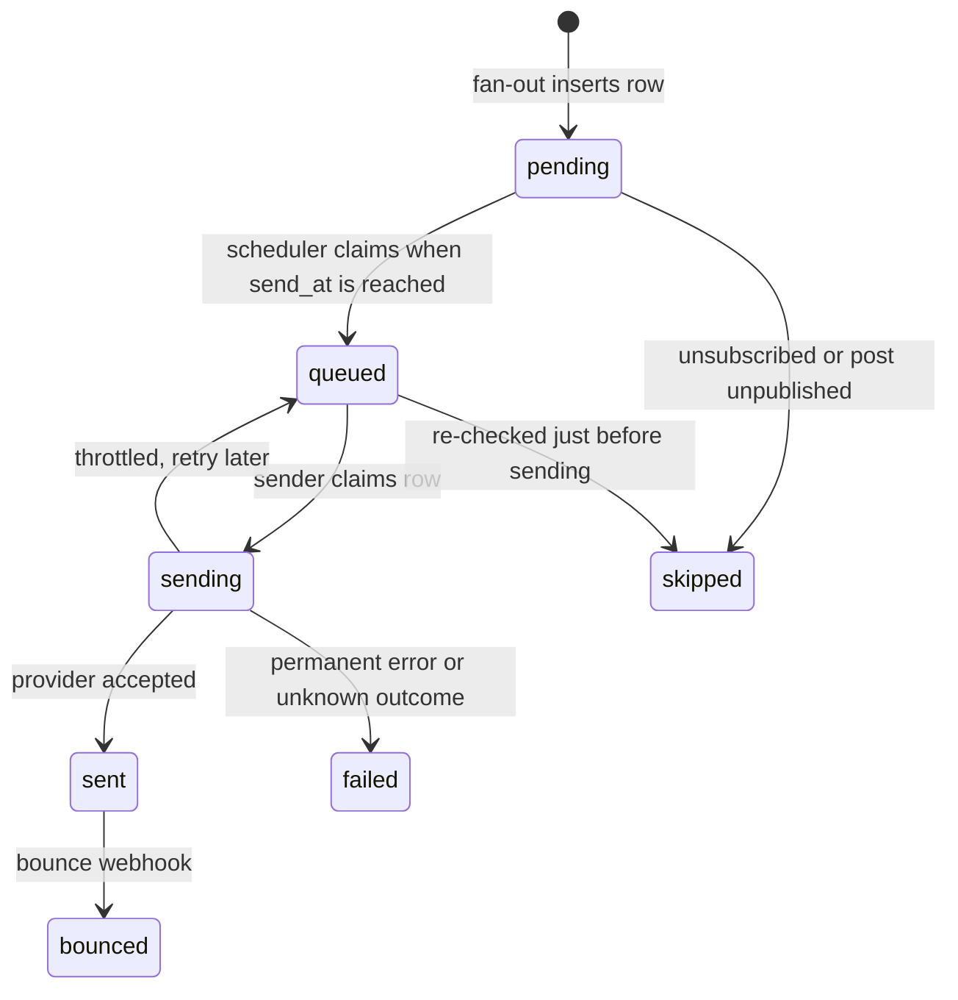

# Flows

Status: draft v1. Each flow says what happens, which table or queue it touches, and why it is safe to retry.

**Conventions**
- Postgres is the source of truth. Queues carry work, not truth.
- Queues deliver at least once, so every consumer is idempotent.
- Time-based decisions use database time (`now()`), not worker clocks.

---

## 1. Publish, outbox, fan-out, send

### 1.1 Publish (API request)
`POST /publications/:pubId/posts/:postId/publish`
Payload: `{ sendImmediately?: boolean }` (default `false`)

In **one transaction**:
1. Conditional update: `UPDATE posts SET status='published' (or 'scheduled'), published_at=..., version=version+1 WHERE id=$1 AND publication_id=$2 AND status='draft' RETURNING *`.
   Zero rows means it was already published (double click or retry): return the existing result and write nothing else.
2. Check `publications.sending_status = 'active'`, else return `SENDING_PAUSED`.
3. Sanitize the body and write `html_preview` and `html_full` into `post_contents`.
4. Insert one `tracked_links` row per outbound link found in the post (only `http` and `https` URLs are allowed).
5. Update the writing streak (see 6.2).
6. Insert an `outbox_events` row: `PostPublished { postId, publicationId, scheduledFor, sendImmediately }`.

Commit, then return **202**. Nothing slow happens inside the request.

### 1.2 Outbox relay
A worker loop, roughly every second:
1. `SELECT ... FROM outbox_events WHERE published_at IS NULL ORDER BY id LIMIT 100 FOR UPDATE SKIP LOCKED`
2. Send each event to the domain-events queue.
3. Set `published_at`, commit.

A crash between steps 2 and 3 republishes the event. That is fine because consumers are idempotent. Delete outbox rows older than 7 days.

### 1.3 Fan-out (page jobs)
The first `PostPublished` message becomes `FanoutPage { postId, afterId: null, sendImmediately }`. Each page job:
1. Select the next 1,000 recipients: `status='active'`, `id > afterId`, ordered by `id`, not on the suppression list (publication-level or platform-wide).
2. Compute `send_at` for each (see 1.4).
3. Insert 1,000 `post_deliveries` rows in one statement with `status='pending'`, `updated_at=now()` and `ON CONFLICT DO NOTHING`.
4. If the page was full, enqueue `FanoutPage { postId, afterId: lastId, sendImmediately }`.

Why pages chain themselves: a crash only repeats one page (the inserts are no-ops the second time), and pages of different publications interleave in the queue, so a 500k publication cannot starve small ones.

### 1.4 Slot scheduling (computing `send_at`)
- If `sendImmediately === true`: `send_at = now()`, bypassing all slot deferrals so delivery is scheduled on the very next scheduler tick.
- If `sendImmediately === false`:
  - Slots (configurable, in the subscriber's timezone): morning 07:00, afternoon 13:00, evening 20:00.
  - `sendAt = next occurrence of the slot time in the subscriber's timezone, not earlier than max(now, post.scheduledFor)`, rounded up to the next 15-minute boundary.
  - This is one pure function, `computeSendAt(now, scheduledFor, slot, tz, sendImmediately)`, tested with a fake clock across timezones.
- If a reader changes slot or timezone while rows are still `pending`, update those rows' `send_at` and `updated_at=now()`.
- Readers who subscribe after fan-out only get later posts.

### 1.5 Scheduler
A worker loop every 15 seconds. **The database is the schedule. The queue only holds work that is due.**
1. If the send queue is deeper than a threshold, skip this tick (backpressure).
2. Find due rows: `status='pending' AND send_at <= now()`, using a partial index on `send_at`. Take up to a fixed number per publication per tick so publications share capacity. Skip publications that are paused or over their `daily_send_limit`.
3. In the same transaction, set those rows to `queued` and update timestamp: `UPDATE post_deliveries SET status='queued', updated_at=now() WHERE ...` (`FOR UPDATE SKIP LOCKED`, so two schedulers never take the same row).
4. After commit, enqueue messages of up to 100 delivery keys each.

A rows-queued-but-message-lost case is repaired by the sweeper (1.7).

### 1.6 Sender
Consumes a batch message of up to 100 delivery keys:
1. **Claim:** one statement, `UPDATE post_deliveries SET status='sending', attempts=attempts+1, updated_at=now() WHERE (keys) AND status='queued' RETURNING ...`. Any key not returned was already claimed or finished, so it is skipped. **This is the duplicate guard.** Every status change must set `updated_at = now()` so the sweeper has accurate freshness.
2. **Check again just before sending:** subscription still `active`, address not suppressed, publication not paused, post still published. Otherwise mark `status='skipped', updated_at=now()`.
3. **Rate limit:** Redis token buckets (provider-wide and per publication). If Redis is down, use a conservative in-memory limit.
4. **Build the email:** personalized unsubscribe link (signed token), `List-Unsubscribe` and `List-Unsubscribe-Post` headers, tracking pixel, rewritten tracked links.
5. **Send** through the `EmailProvider` interface, with a timeout.
6. **Record the result** in batched updates (all updating `updated_at=now()`):
   - Accepted: `status='sent'`, `provider_message_id`, `sent_at=now()`, `updated_at=now()`.
   - Explicit throttle or temporary rejection: back to `status='queued'`, `updated_at=now()` with a delayed retry (exponential backoff plus jitter) until attempts run out, then `status='failed'`, `updated_at=now()`.
   - Permanent rejection (invalid address): `status='failed'`, `updated_at=now()`, plus a suppression row.
   - Timeout or connection loss after the request was sent: the outcome is **unknown**. Mark `status='failed'` with `last_error='unknown_outcome'`, `updated_at=now()`. Never resend automatically.
7. Delete the queue message only after the batch is recorded. Set the visibility timeout longer than the worst-case batch time.

### 1.7 Sweeper (every few minutes)
- Rows stuck in `sending` longer than 10 minutes (based on `updated_at`): mark `status='failed'` with `last_error='unknown_outcome'`, `updated_at=now()`, and count them in a metric.
- Rows in `queued` longer than 30 minutes past `send_at`: put back to `status='pending'`, `updated_at=now()` (safe, because they were never claimed).

### 1.8 Bounce and complaint events
Handled by the webhook path (section 3). A hard bounce or complaint inserts a `suppressions` row and sets the delivery to `bounced`. A complaint rate over the threshold sets the publication's `sending_status='paused'`.

### Delivery row states

**Delivery guarantee:** at most once per recipient per post. A duplicate cannot happen because only one worker can move a row from `queued` to `sending`. The cost is that if a worker dies while a send is in flight, that email's outcome is unknown. At most one worker's concurrency limit worth of emails are affected per crash, and they are counted and reported. See ADR-009.

---

## 2. Tracking (opens and clicks)

**Process Isolation:** The tracking endpoints (`/t/o/:token.gif` and `/t/c/:token`) run as a dedicated, standalone process (same codebase, dedicated entrypoint `apps/api/src/tracking-server.ts` or `apps/tracking`). This protects the main API from event-loop saturation or connection-pool starvation when an email blast triggers sudden traffic spikes.

**Token:** `base64url(payload).base64url(HMAC)`, where the payload holds a version, key id, subscription id, post id and link id. The key id allows key rotation.

### 2.1 Open pixel `GET /t/o/:token.gif`
1. Verify the signature (no database needed). Invalid: return the pixel anyway, record nothing.
2. Build an event with a fresh `eventId` and an `isPrefetch` guess (known mail-proxy user agents or address ranges; this is best effort).
3. Put it in an in-memory buffer that flushes to the tracking queue in batches (about every 200 ms).
4. Return the 1x1 GIF immediately with `Cache-Control: no-store`.

### 2.2 Click `GET /t/c/:token`
1. Verify the signature.
2. Look up the target URL by link id: in-process LRU, then Redis, then Postgres. Links never change, so cached entries never need invalidating.
3. Buffer the click event the same way as opens.
4. Respond **302** to the stored URL. Never redirect to a URL taken from the request.

If the queue is unreachable the endpoint still answers: the buffer is bounded, and overflow events are dropped and counted (`tracking_events_dropped_total`). A reader is never blocked by analytics.

### 2.3 Consumer
1. Read up to 1,000 events or wait 1 second, whichever comes first.
2. Insert the batch into ClickHouse (`ReplacingMergeTree` keyed on `eventId`, so redelivery does not double count).
3. Acknowledge only after the insert succeeds. Repeated failures go to the dead-letter queue.

### 2.4 Rollups
A ClickHouse materialized view aggregates per post and day: human opens (`isPrefetch=false`), prefetch opens, unique openers, clicks per link. Dashboards read rollups, never raw events.

---

## 3. Billing and email-event webhooks

### 3.1 Checkout
1. `POST /public/:subdomain/checkout` (logged in): call Razorpay to create the subscription, then insert `paid_subscriptions` with `status='created'` **before** returning checkout parameters.
2. The browser's payment-success callback only shows "processing". It never grants access.

### 3.2 Receiving a webhook (API)
1. Read the **raw body**.
2. Verify the signature with a constant-time comparison. Failure: 401.
3. `INSERT INTO webhook_events (provider, provider_event_id, type, payload, ...) ON CONFLICT DO NOTHING`. A duplicate delivery stops here with 200.
4. Enqueue the event id, return **200**.

### 3.3 Processing (worker)
In one transaction:
1. `SELECT ... FROM paid_subscriptions WHERE razorpay_subscription_id=$1 FOR UPDATE`.
2. If the event's timestamp is not newer than `last_event_at`: ignore it (stale).
3. Otherwise apply the status change, set `current_period_end` from the payload, set `last_event_at`.
4. Mark the `webhook_events` row processed.

After commit, delete the cached entitlement key. If the row does not exist yet, requeue with a delay, and send to the dead-letter queue after several attempts.

Verify the exact Razorpay event names and payload fields against their documentation when implementing.

### 3.4 Entitlement check (paid post body)
`isEntitled(userId, publicationId)`:
1. Redis lookup (TTL 60 seconds).
2. Miss, or Redis down: query Postgres. Entitled if there is a `paid_subscriptions` row with status `active`, or a cancelled one whose `current_period_end` is still in the future.
3. Postgres unavailable too: answer **503 try again**, not 403, so a paying reader is not told they lack access.

### 3.5 Reconciliation job (hourly)
For rows in `created`, `active` or `halted` whose `last_event_at` is old, or whose `current_period_end` has passed: fetch the subscription from Razorpay and feed it through the **same transition function** as a webhook. Abandoned `created` rows older than 24 hours become `expired`. This repairs lost webhooks.

### 3.6 SES bounce and complaint events
The same pipeline (`/webhooks/ses`, after SNS signature verification). Worker: hard bounce or complaint inserts a suppression row, updates the delivery row, and evaluates the publication's complaint rate.

---

## 4. Quote card

`POST /public/:subdomain/posts/:slug/quote-cards { quote }`
1. Rate limit per IP.
2. Normalize the quote (Unicode NFC, collapsed whitespace). Reject over 200 characters.
3. **Pick the text to match against:** free post: full text. Paid post: the preview text only, unless the caller is entitled. Otherwise the endpoint becomes an oracle that confirms whether a phrase appears in paid content.
4. Reject with `QUOTE_NOT_IN_POST` if the quote is not a substring of that text (plain text is cached per post version).
5. `hash = sha256(postId + normalizedQuote + templateVersion)`. If `quote_cards (post_id, quote_hash)` exists, return its URL.
6. Otherwise render: Satori turns a template into SVG using the right font for the post language (Devanagari, Tamil, and so on), resvg turns it into PNG. Limit concurrent renders (for example 2) and set a timeout.
7. Store the PNG through the `ObjectStorage` interface (local disk in the demo, S3 in the blueprint) at `cards/{hash}.png`, insert the row with `ON CONFLICT DO NOTHING`, return the URL.

Two simultaneous identical requests both render and one insert wins, which is harmless. Card URLs are immutable, so the CDN caches them forever. On unpublish, an outbox event deletes the post's card files.

---

## 5. Subscribe and unsubscribe

**Subscribe:** `POST /public/:subdomain/subscribe` always returns 202. In one transaction insert or find the `pending` row (unique on publication and email). Send a confirmation email only if the per-address limit allows. The confirm link carries a one-time token; its hash is stored.

**Confirm:** in one transaction, conditional update `pending -> active`, set `confirmed_at`, increment `publications.subscriber_count`, and insert an outbox event `SubscriptionConfirmed`. The conditional update means the counter increments once even if the link is clicked twice.

**Unsubscribe:** signed token, no login. Set `status='unsubscribed'` and `unsubscribed_at`. Pending delivery rows are skipped by the sender's last-moment check.

---

## 6. Milestones and streaks

### 6.1 Milestones
Consumer of `SubscriptionConfirmed`: for each threshold (10, 100, 1,000) that `subscriber_count` has reached, `INSERT INTO milestones ... ON CONFLICT DO NOTHING RETURNING`. Only when a row is actually inserted, notify the writer. That is why a retried event never celebrates twice.

### 6.2 Streak
Done inside the publish transaction, using the ISO week in IST: same week as `last_post_week` means no change, the previous week means `current_weeks + 1`, anything older resets to 1. Update `longest_weeks` if exceeded.

---

## Data model changes caused by these flows
- `post_deliveries.status` gains two values: `queued` and `sending` (a `CHECK` constraint, no new column for it).
- `post_deliveries` gains `updated_at timestamptz` (used by the sweeper).
- Everything else is unchanged.

## Decisions & open points
1. **Does "publish now" ignore slots?** Resolved: Controlled by `sendImmediately: boolean` in `POST /publications/:pubId/posts/:postId/publish`. When true, `send_at` is set directly to `now()`, bypassing slot deferrals. When false, slot scheduling determines `send_at`.
2. **Unknown-outcome policy:** currently never auto-resend. Alternative is a writer-triggered "resend to these" action.
3. **Slot times** (07:00, 13:00, 20:00) are assumptions.