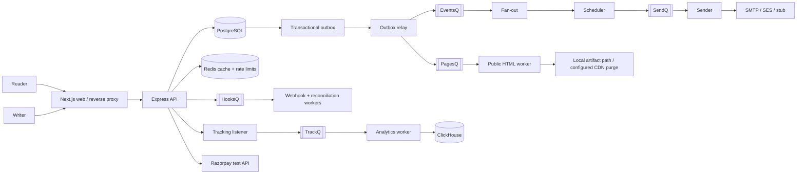

# Vichaar repository guide

This guide is based on a selective read of the repository. It describes the current local implementation; deployment claims are kept separate from what the code and docs verify.

## 1. Purpose

Vichaar is a newsletter platform for independent Indian writers and their readers. A writer can create a publication, draft and publish free or paid letters, schedule delivery, inspect readers and analytics, and manage publication settings. A reader can discover a publication, subscribe through double opt-in, receive email, read public previews, and obtain paid access through Razorpay test mode. The product is India-first: IST is the default timezone, prices are integer paise, and posts carry a language tag. The stated audience and product scope are in [`README.md`](../README.md); the primary entities are defined in [`packages/db/src/schema/domain.ts`](../packages/db/src/schema/domain.ts).

## 2. Stack and exact local commands

### Stack

- TypeScript with strict compiler settings and a pnpm workspace; the root scripts and workspace are in [`package.json`](../package.json), [`pnpm-workspace.yaml`](../pnpm-workspace.yaml), and [`tsconfig.base.json`](../tsconfig.base.json).
- Express 5 API with modular route/service/repository modules in [`apps/api/package.json`](../apps/api/package.json) and [`apps/api/src/modules/`](../apps/api/src/modules/).
- Next.js web application for public reading, reader account pages, and the writer studio in [`apps/web/package.json`](../apps/web/package.json) and [`apps/web/src/app/`](../apps/web/src/app/).
- PostgreSQL with Drizzle-oriented TypeScript schema definitions and SQL migrations in [`packages/db/src/schema/`](../packages/db/src/schema/), [`packages/db/src/migrations/`](../packages/db/src/migrations/), and [`packages/db/src/migrate.ts`](../packages/db/src/migrate.ts).
- Redis for rate limiting and cache state, ElasticMQ locally / SQS-shaped queues in production, and ClickHouse for tracking analytics; the queue contracts are in [`packages/queue/src/index.ts`](../packages/queue/src/index.ts), while the local dependencies are in [`infra/compose/docker-compose.yml`](../infra/compose/docker-compose.yml).
- Mailpit/SMTP, SES, or a stub email provider through the `EmailProvider` interface in [`apps/workers/src/provider.ts`](../apps/workers/src/provider.ts); Razorpay billing integration is in [`apps/api/src/modules/billing/`](../apps/api/src/modules/billing/).
- Vitest for unit/integration/chaos tests and Playwright for the critical browser flow, configured by [`vitest.config.ts`](../vitest.config.ts), [`playwright.config.ts`](../playwright.config.ts), and [`apps/web/e2e/critical-flow.e2e.ts`](../apps/web/e2e/critical-flow.e2e.ts).

### Install and run

Requirements are Node.js 22.12+, pnpm 9, and Docker Compose ([`README.md`](../README.md)). From the repository root:

```bash
pnpm install
pnpm stack:up
pnpm db:migrate
pnpm dev
```

The web server is normally at `http://localhost:3000`, the API at `http://localhost:4000`, and the tracking listener at `http://localhost:4001` ([`README.md`](../README.md), [`apps/api/src/dev.ts`](../apps/api/src/dev.ts), [`apps/api/src/tracking-server.ts`](../apps/api/src/tracking-server.ts)). Local workers need `AWS_ACCESS_KEY_ID=test` and `AWS_SECRET_ACCESS_KEY=test`; `.env.example` documents the other variables ([`.env.example`](../.env.example), [`apps/workers/src/dev.ts`](../apps/workers/src/dev.ts)).

Useful checks and data commands:

```bash
pnpm db:seed
pnpm lint
pnpm test
PLAYWRIGHT_CHANNEL=chrome pnpm test:e2e
pnpm build
pnpm loadtest
pnpm chaos
pnpm stack:down
```

The meaning of each command and the test prerequisites are documented in [`README.md`](../README.md); the script definitions are in [`package.json`](../package.json). `pnpm test` expects local PostgreSQL, Redis, ElasticMQ, and Docker access for the ClickHouse chaos test ([`.github/workflows/ci.yml`](../.github/workflows/ci.yml), [`chaos/clickhouse-storm.test.ts`](../chaos/clickhouse-storm.test.ts)).

## 3. Top-level directory map

- `apps/api/` — Express API bootstrap, dependency-injection container, tracking listener, and domain modules for auth, publications, posts, subscriptions, billing, analytics, quote cards, milestones, and health ([`apps/api/src/`](../apps/api/src/)).
- `apps/web/` — Next.js routes, layouts, components, browser/server API clients, CSS, and the critical Playwright flow ([`apps/web/src/`](../apps/web/src/), [`apps/web/e2e/`](../apps/web/e2e/)).
- `apps/workers/` — outbox relay, fan-out, scheduler, sender, sweeper, webhook, reconciliation, analytics, and public-page worker code ([`apps/workers/src/index.ts`](../apps/workers/src/index.ts), [`apps/workers/src/`](../apps/workers/src/)).
- `packages/db/` — PostgreSQL client, schema, migration runner, seed helper, and partition maintenance ([`packages/db/src/`](../packages/db/src/)).
- `packages/queue/` — typed SQS-compatible queue clients, Zod message contracts, local queue lifecycle, and tracing ([`packages/queue/src/index.ts`](../packages/queue/src/index.ts)).
- `packages/shared/` — shared errors, clocks, scheduling, signed tokens, tracking helpers, and Zod request contracts ([`packages/shared/src/`](../packages/shared/src/)).
- `infra/compose/` — local PostgreSQL, replica, Redis, ElasticMQ, ClickHouse, and Mailpit dependency stack ([`infra/compose/docker-compose.yml`](../infra/compose/docker-compose.yml)).
- `infra/monitoring/` — alert rules for worker and public-page lag ([`infra/monitoring/alerts.yml`](../infra/monitoring/alerts.yml)).
- `docs/` — system design, implementation plans, flows, threat/failure analysis, benchmarks, and ADRs ([`docs/design.md`](../docs/design.md), [`docs/flows.md`](../docs/flows.md), [`docs/adr/`](../docs/adr/)).
- `chaos/` — failure-injection tests for Redis, ClickHouse, webhook replay, and sender crashes ([`chaos/`](../chaos/)).
- `loadtests/` — delivery and scheduling benchmark scripts ([`loadtests/`](../loadtests/)).
- `tests/` — workspace-level boundary-rule verification ([`tests/boundary-rule.test.ts`](../tests/boundary-rule.test.ts)).
- `fixtures/` — intentionally invalid imports used by the boundary test ([`fixtures/boundary-violation-fixture/`](../fixtures/boundary-violation-fixture/)).
- `scripts/` — operational/local measurement scripts, including web-vitals measurement ([`scripts/`](../scripts/)).
- `output/` — generated browser-review artifacts and screenshots ([`output/playwright/`](../output/playwright/)).
- `data/` — local quote-card and public HTML artifact directories; these are runtime data locations, not source ([`.gitignore`](../.gitignore), [`apps/workers/src/public-pages.ts`](../apps/workers/src/public-pages.ts)).
- `.github/` — GitHub Actions CI for lint, typecheck, build, tests, audit, and secret scanning ([`.github/workflows/ci.yml`](../.github/workflows/ci.yml)).

There are no repository Dockerfiles in the sampled tree; the Compose file runs dependencies while the API, web, and worker processes run as Node processes in the documented local workflow ([`infra/compose/docker-compose.yml`](../infra/compose/docker-compose.yml), [`README.md`](../README.md)). A production container arrangement is explicitly future work, not an implemented deployment ([`README.md`](../README.md)).

## 4. Architecture and data flow

The system is a modular monolith plus separately run workers. PostgreSQL is the durable source of truth. Redis is cache/rate-limit state, queues use an SQS API, and ClickHouse receives tracking events in batches. Domain changes are written to an outbox in the same transaction and later relayed to queues ([`docs/design.md`](../docs/design.md), [`docs/adr/004_TransactionalOutbox.md`](../docs/adr/004_TransactionalOutbox.md), [`apps/workers/src/pipeline.ts`](../apps/workers/src/pipeline.ts)).



The component inventory and intended production edge are also captured in [`HighLevelArchitecture.mmd`](../HighLevelArchitecture.mmd). The current local page worker writes files but the repository explicitly leaves live CDN routing and purge verification as a deployment gate ([`docs/adr/015_PublicHtmlArtifacts.md`](../docs/adr/015_PublicHtmlArtifacts.md), [`docs/frontend-phase-plan.md`](../docs/frontend-phase-plan.md)).

## 5. Entry points

- Root commands are defined in [`package.json`](../package.json); the workspace packages are listed in [`pnpm-workspace.yaml`](../pnpm-workspace.yaml).
- API process: [`apps/api/src/dev.ts`](../apps/api/src/dev.ts) spawns `src/index.ts` and `src/tracking-server.ts`; [`apps/api/src/index.ts`](../apps/api/src/index.ts) parses environment configuration, builds the container, and listens; [`apps/api/src/server.ts`](../apps/api/src/server.ts) creates the Express app and mounts middleware/routes.
- Tracking process: [`apps/api/src/tracking-server.ts`](../apps/api/src/tracking-server.ts) creates the separate open-pixel/click listener and its queue client.
- Worker process: [`apps/workers/src/dev.ts`](../apps/workers/src/dev.ts) creates local queues and spawns worker roles; [`apps/workers/src/index.ts`](../apps/workers/src/index.ts) parses configuration, builds the worker container, selects a role, and runs its loop.
- Web process: Next.js resolves pages under [`apps/web/src/app/`](../apps/web/src/app/); the root page is [`apps/web/src/app/page.tsx`](../apps/web/src/app/page.tsx), the public publication route is [`apps/web/src/app/p/[subdomain]/page.tsx`](../apps/web/src/app/p/%5Bsubdomain%5D/page.tsx), and the public post route is [`apps/web/src/app/p/[subdomain]/[slug]/page.tsx`](../apps/web/src/app/p/%5Bsubdomain%5D/%5Bslug%5D/page.tsx).
- Database migration entry point: [`packages/db/src/migrate.ts`](../packages/db/src/migrate.ts), invoked by the `db:migrate` root script ([`package.json`](../package.json)).
- CI entry point: [`.github/workflows/ci.yml`](../.github/workflows/ci.yml), which runs lint/typecheck/build, dependency startup, migrations, tests, audit, and Gitleaks.

## 6. Core domain concepts and data models

The canonical relational model is in [`packages/db/src/schema/domain.ts`](../packages/db/src/schema/domain.ts); SQL migration history is in [`packages/db/src/migrations/`](../packages/db/src/migrations/).

- `users` and `sessions` represent writer accounts and hashed cookie-backed sessions.
- `publications` is the tenant boundary: it owns posts, subscriptions, billing, analytics, and reader data.
- `posts` and `post_contents` represent slugged letters, language, access (`free`/`paid`), lifecycle status, scheduling, sanitized preview/full HTML, and optimistic versioning.
- `outbox_events` records domain events durably before queue relay; `tracked_links` stores publish-time link destinations.
- `subscriptions` and `suppressions` implement double opt-in, delivery slot/timezone preferences, and unsubscribe protection.
- `post_deliveries` is the durable per-post/per-subscriber send ledger, partitioned by stable publish month and keyed to suppress duplicate fan-out rows.
- `billing_plans`, `paid_subscriptions`, and `webhook_events` model Razorpay test-mode plans, account-bound entitlements, and idempotent webhook intake.
- `quote_cards`, `milestones`, and `writing_streaks` hold generated-card metadata and exactly-once milestone/streak state.
- Tracking events are not modeled as per-event PostgreSQL rows in the domain schema; signed tracking messages go to TrackQ and are batched into ClickHouse ([`apps/api/src/modules/tracking/`](../apps/api/src/modules/tracking/), [`apps/workers/src/analytics.ts`](../apps/workers/src/analytics.ts), [`docs/adr/013_TrackingProcessAndClickHouseRollups.md`](../docs/adr/013_TrackingProcessAndClickHouseRollups.md)).

Shared input and output contracts are Zod schemas in [`packages/shared/src/schemas/`](../packages/shared/src/schemas/) and queue contracts in [`packages/queue/src/index.ts`](../packages/queue/src/index.ts).

## 7. Three end-to-end flows

### Flow A: writer signup and session

1. `POST /auth/signup` is mounted by `createServer()` in [`apps/api/src/server.ts`](../apps/api/src/server.ts).
2. `createAuthRouter()` validates the request and calls the injected auth service ([`apps/api/src/modules/auth/routes.ts`](../apps/api/src/modules/auth/routes.ts)).
3. `createAuthService()` hashes the password, creates the user/session, and returns the session result ([`apps/api/src/modules/auth/service.ts`](../apps/api/src/modules/auth/service.ts)).
4. `createAuthRepository()` persists users and hashed session tokens in PostgreSQL ([`apps/api/src/modules/auth/repository.ts`](../apps/api/src/modules/auth/repository.ts), [`packages/db/src/schema/domain.ts`](../packages/db/src/schema/domain.ts)).
5. The route sets the session cookie; browser callers use the same-origin client in [`apps/web/src/lib/api/browser.ts`](../apps/web/src/lib/api/browser.ts), and the form is rendered by [`apps/web/src/components/auth-form.tsx`](../apps/web/src/components/auth-form.tsx).

Question to answer while reading: where are cookie attributes and session expiry enforced, and which requests require the authenticated session?

### Flow B: publish a post and read it publicly

1. The writer uses the Next.js studio pages under [`apps/web/src/app/studio/[publicationId]/posts/`](../apps/web/src/app/studio/%5BpublicationId%5D/posts/) and [`apps/web/src/components/studio-post-editor.tsx`](../apps/web/src/components/studio-post-editor.tsx).
2. The API mounts the owner-scoped post router in `createServer()` ([`apps/api/src/server.ts`](../apps/api/src/server.ts)); route handlers call `createPostService()` ([`apps/api/src/modules/posts/routes.ts`](../apps/api/src/modules/posts/routes.ts), [`apps/api/src/modules/posts/service.ts`](../apps/api/src/modules/posts/service.ts)).
3. The post repository writes the tenant-scoped post/content, sanitizes publish content through the service path, and records publish/unpublish outbox state ([`apps/api/src/modules/posts/repository.ts`](../apps/api/src/modules/posts/repository.ts), [`apps/api/src/modules/posts/service.ts`](../apps/api/src/modules/posts/service.ts), [`packages/db/src/schema/domain.ts`](../packages/db/src/schema/domain.ts)).
4. The relay publishes the outbox event to EventsQ and PagesQ; the page worker re-reads publication/post status, fetches anonymous Next.js HTML, atomically writes an artifact, and purges configured public URLs ([`apps/workers/src/pipeline.ts`](../apps/workers/src/pipeline.ts), [`apps/workers/src/public-pages.ts`](../apps/workers/src/public-pages.ts), [`docs/adr/015_PublicHtmlArtifacts.md`](../docs/adr/015_PublicHtmlArtifacts.md)).
5. A reader requests `/p/:subdomain` or `/p/:subdomain/:slug`; Next.js server pages call the public API client, which calls `/public/:subdomain` and `/public/:subdomain/posts/:slug` ([`apps/web/src/app/p/[subdomain]/page.tsx`](../apps/web/src/app/p/%5Bsubdomain%5D/page.tsx), [`apps/web/src/app/p/[subdomain]/[slug]/page.tsx`](../apps/web/src/app/p/%5Bsubdomain%5D/%5Bslug%5D/page.tsx), [`apps/web/src/lib/api/public.ts`](../apps/web/src/lib/api/public.ts)).
6. Paid public reads receive only preview HTML; full content is fetched through the authenticated path and checked by the billing entitlement service ([`apps/api/src/modules/posts/routes.ts`](../apps/api/src/modules/posts/routes.ts), [`apps/api/src/modules/billing/service.ts`](../apps/api/src/modules/billing/service.ts), [`apps/web/src/app/p/[subdomain]/[slug]/page.tsx`](../apps/web/src/app/p/%5Bsubdomain%5D/%5Bslug%5D/page.tsx)).

Question to answer while reading: which cache keys and status/version checks prevent a stale or cross-tenant post from being returned?

### Flow C: subscription confirmation to newsletter delivery

1. The public Next.js subscription form posts through the browser API client; the API mounts the public subscription route in `createServer()` ([`apps/web/src/components/subscribe-form.tsx`](../apps/web/src/components/subscribe-form.tsx), [`apps/web/src/lib/api/browser.ts`](../apps/web/src/lib/api/browser.ts), [`apps/api/src/server.ts`](../apps/api/src/server.ts)).
2. `createSubscriptionRouter()` validates the subdomain/body and calls `createSubscriptionService().subscribe()` ([`apps/api/src/modules/subscriptions/routes.ts`](../apps/api/src/modules/subscriptions/routes.ts), [`apps/api/src/modules/subscriptions/service.ts`](../apps/api/src/modules/subscriptions/service.ts)).
3. The subscription repository stores a pending, tenant-scoped subscription and confirmation hash; the transaction emits `SubscriptionConfirmationRequested` without placing a usable raw token in the queue ([`apps/api/src/modules/subscriptions/repository.ts`](../apps/api/src/modules/subscriptions/repository.ts), [`docs/adr/011_ConfirmationOutboxAndAtMostOnceDispatch.md`](../docs/adr/011_ConfirmationOutboxAndAtMostOnceDispatch.md)).
4. Relay and fan-out workers consume the event; the sender uses the injected email provider, whose local SMTP mode targets Mailpit ([`apps/workers/src/pipeline.ts`](../apps/workers/src/pipeline.ts), [`apps/workers/src/provider.ts`](../apps/workers/src/provider.ts), [`infra/compose/docker-compose.yml`](../infra/compose/docker-compose.yml)).
5. The confirmation link reaches the confirmation route, which conditionally changes `pending` to `active` and emits `SubscriptionConfirmed` ([`apps/api/src/modules/subscriptions/routes.ts`](../apps/api/src/modules/subscriptions/routes.ts), [`apps/api/src/modules/subscriptions/service.ts`](../apps/api/src/modules/subscriptions/service.ts)).
6. A published post later creates `post_deliveries`; the scheduler queues due rows, the sender atomically claims them, checks status/suppression/rate limits, and sends the appropriate free or paid body ([`apps/workers/src/pipeline.ts`](../apps/workers/src/pipeline.ts), [`packages/db/src/schema/domain.ts`](../packages/db/src/schema/domain.ts), [`docs/adr/009_Database-drivenSlotSchedulingAndAt-most-onceSsending.md`](../docs/adr/009_Database-drivenSlotSchedulingAndAt-most-onceSsending.md)).

Question to answer while reading: what happens after an email provider timeout, and why is the delivery outcome not automatically retried?

## 8. External dependencies and required environment

- PostgreSQL primary and local replica: `DATABASE_URL`, `DATABASE_REPLICA_URL` ([`.env.example`](../.env.example), [`infra/compose/docker-compose.yml`](../infra/compose/docker-compose.yml)).
- Redis: `REDIS_URL`; used for rate limits, preview cache, and entitlement cache ([`apps/api/src/shared/cache.ts`](../apps/api/src/shared/cache.ts), [`apps/api/src/shared/rate-limiter.ts`](../apps/api/src/shared/rate-limiter.ts)).
- ElasticMQ/SQS: `SQS_ENDPOINT`, `SQS_QUEUE_BASE_URL`, `AWS_REGION`, `AWS_ACCESS_KEY_ID`, `AWS_SECRET_ACCESS_KEY` ([`.env.example`](../.env.example), [`packages/queue/src/index.ts`](../packages/queue/src/index.ts)).
- Mailpit/SMTP, SES, or stub: `EMAIL_PROVIDER`, `EMAIL_FROM`, `MAILPIT_SMTP_HOST`, `MAILPIT_SMTP_PORT`, and SES verified-address configuration ([`.env.example`](../.env.example), [`apps/workers/src/provider.ts`](../apps/workers/src/provider.ts)).
- ClickHouse: `CLICKHOUSE_URL`, `CLICKHOUSE_DB`, `CLICKHOUSE_USER`, `CLICKHOUSE_PASSWORD` ([`.env.example`](../.env.example), [`apps/workers/src/analytics.ts`](../apps/workers/src/analytics.ts)).
- Razorpay test mode: `RAZORPAY_KEY_ID`, `RAZORPAY_KEY_SECRET`, `RAZORPAY_WEBHOOK_SECRET` ([`.env.example`](../.env.example), [`apps/api/src/modules/billing/provider.ts`](../apps/api/src/modules/billing/provider.ts), [`docs/adr/012_billingWebhookInbox.md`](../docs/adr/012_billingWebhookInbox.md)).
- Public web/tracking and security: `PUBLIC_BASE_URL`, `WEB_ORIGIN`, `API_ORIGIN`, `CORS_ORIGIN`, `TOKEN_HMAC_SECRET`, and `TRACKING_HMAC_SECRET` ([`.env.example`](../.env.example), [`apps/api/src/index.ts`](../apps/api/src/index.ts), [`apps/api/src/tracking-server.ts`](../apps/api/src/tracking-server.ts)).
- Public artifacts and cards: `PUBLIC_HTML_DIR`, `QUOTE_CARD_DIR`, optionally `CLOUDFLARE_ZONE_ID` and `CLOUDFLARE_API_TOKEN` ([`.env.example`](../.env.example), [`apps/workers/src/public-pages.ts`](../apps/workers/src/public-pages.ts), [`apps/api/src/container.ts`](../apps/api/src/container.ts)).
- Docker services are local-only in the Compose configuration. The repository does not establish a deployed production topology; the README calls the deployment containers and Terraform blueprint future work ([`infra/compose/docker-compose.yml`](../infra/compose/docker-compose.yml), [`README.md`](../README.md)).

## 9. Conventions and patterns

- Layering is route → service → repository → database; services and repositories are constructed with factories and do not import Express types. The lint rules and the fixture test enforce this ([`AGENTS.md`](../AGENTS.md), [`eslint.config.js`](../eslint.config.js), [`tests/boundary-rule.test.ts`](../tests/boundary-rule.test.ts)).
- Modules expose an `index.ts` public surface; other modules should import that surface rather than internal files ([`apps/api/src/modules/posts/index.ts`](../apps/api/src/modules/posts/index.ts), [`eslint.config.js`](../eslint.config.js)).
- External inputs and queue messages are validated with Zod at boundaries ([`packages/shared/src/schemas/`](../packages/shared/src/schemas/), [`packages/queue/src/index.ts`](../packages/queue/src/index.ts)).
- Errors are typed `AppError` subclasses and reach one central Express error handler; responses avoid stack traces ([`packages/shared/src/errors.ts`](../packages/shared/src/errors.ts), [`apps/api/src/server.ts`](../apps/api/src/server.ts)).
- Structured logging uses pino with correlation IDs; tracing wraps HTTP, queue, database, email, and external calls ([`apps/api/src/shared/logger.ts`](../apps/api/src/shared/logger.ts), [`apps/api/src/server.ts`](../apps/api/src/server.ts), [`apps/workers/src/tracing.ts`](../apps/workers/src/tracing.ts)).
- Money is integer paise, timestamps are UTC, and timezone conversion is an edge concern ([`packages/db/src/schema/domain.ts`](../packages/db/src/schema/domain.ts), [`packages/shared/src/scheduling.ts`](../packages/shared/src/scheduling.ts), [`docs/design.md`](../docs/design.md)).
- Tenant data access carries `publicationId`; repositories and tests cover cross-tenant denial ([`apps/api/src/modules/publications/repository.ts`](../apps/api/src/modules/publications/repository.ts), [`apps/api/tests/domain-live.test.ts`](../apps/api/tests/domain-live.test.ts)).
- Queue consumers are idempotent and delivery is deliberately at-most-once: claim before provider send, and mark ambiguous outcomes unknown rather than automatically resending ([`apps/workers/src/pipeline.ts`](../apps/workers/src/pipeline.ts), [`docs/adr/009_Database-drivenSlotSchedulingAndAt-most-onceSsending.md`](../docs/adr/009_Database-drivenSlotSchedulingAndAt-most-onceSsending.md)).
- Public reads are cache-aware, paid bodies are private, and analytics responds before enqueueing tracking work ([`apps/api/src/shared/cache.ts`](../apps/api/src/shared/cache.ts), [`apps/api/src/modules/posts/routes.ts`](../apps/api/src/modules/posts/routes.ts), [`docs/adr/007_cachingStrategy.md`](../docs/adr/007_cachingStrategy.md), [`docs/adr/013_TrackingProcessAndClickHouseRollups.md`](../docs/adr/013_TrackingProcessAndClickHouseRollups.md)).

## 10. Risky or confusing areas

- **Deployment boundary:** local public HTML artifacts are implemented, but the reverse proxy/CDN routing, cookie bypass, purge verification, and field INP checks remain open. Treat any claim that the CDN is live as **UNVERIFIED** ([`docs/adr/015_PublicHtmlArtifacts.md`](../docs/adr/015_PublicHtmlArtifacts.md), [`docs/frontend-phase-plan.md`](../docs/frontend-phase-plan.md)).
- **Billing launch readiness:** the repository records an account-email verification gap and a possible orphaned remote Razorpay subscription after a crash. Live-payment readiness is therefore **UNVERIFIED** and explicitly not claimed ([`docs/adr/012_billingWebhookInbox.md`](../docs/adr/012_billingWebhookInbox.md), [`README.md`](../README.md)).
- **Production capacity:** the 2-vCPU/12-GB target and production email throughput are design targets, not a verified deployment measurement ([`docs/design.md`](../docs/design.md), [`docs/benchmarks.md`](../docs/benchmarks.md), [`README.md`](../README.md)).
- **Static artifacts versus personalized reads:** the page worker intentionally renders without cookies; session-bearing requests must bypass shared static/CDN content. Whether every future proxy configuration preserves that invariant is **UNVERIFIED** until deployment tests exist ([`apps/workers/src/public-pages.ts`](../apps/workers/src/public-pages.ts), [`docs/adr/015_PublicHtmlArtifacts.md`](../docs/adr/015_PublicHtmlArtifacts.md)).
- **Local process orchestration:** `pnpm dev` uses Turbo and process spawners rather than a single application server; exact process supervision outside the local workflow is **UNVERIFIED** ([`package.json`](../package.json), [`apps/api/src/dev.ts`](../apps/api/src/dev.ts), [`apps/workers/src/dev.ts`](../apps/workers/src/dev.ts)).
- **Test prerequisites:** some tests require Docker and live local services, while CI provisions those services. A plain `pnpm test` on a machine without them is expected to fail or skip depending on the test ([`.github/workflows/ci.yml`](../.github/workflows/ci.yml), [`chaos/`](../chaos/), [`apps/workers/tests/analytics-live.test.ts`](../apps/workers/tests/analytics-live.test.ts)).
- **Documentation status labels:** several ADRs are historical/proposed while later implementation and README status are the better source for what is currently running. When they differ, confirm the implementation and the latest roadmap entry; the repository does not provide a generated architecture inventory ([`docs/adr/`](../docs/adr/), [`README.md`](../README.md)).

## Recommended reading order

1. [`README.md`](../README.md) — establish the product scope, local commands, current roadmap, and explicit non-claims; ask: what is implemented locally versus deferred?
2. [`AGENTS.md`](../AGENTS.md) — learn the repository’s hard architecture, security, testing, and operational rules; ask: which invariants must every change preserve?
3. [`docs/design.md`](../docs/design.md) — understand capacity assumptions, cache boundaries, data model, and resource budget; ask: why are PostgreSQL, Redis, queues, and ClickHouse separated?
4. [`HighLevelArchitecture.mmd`](../HighLevelArchitecture.mmd) — get the component topology; ask: which traffic paths are synchronous and which are asynchronous?
5. [`infra/compose/docker-compose.yml`](../infra/compose/docker-compose.yml) — see the local dependency topology and ports; ask: which services must exist before the app starts?
6. [`apps/api/src/index.ts`](../apps/api/src/index.ts) — see API configuration and bootstrap; ask: which environment values are required and what does the container construct?
7. [`apps/api/src/server.ts`](../apps/api/src/server.ts) — trace middleware ordering and route mounting; ask: where do authentication, tenant checks, rate limits, and errors happen?
8. [`apps/api/src/container.ts`](../apps/api/src/container.ts) — understand dependency injection and provider selection; ask: which services are optional in local mode?
9. [`packages/db/src/schema/domain.ts`](../packages/db/src/schema/domain.ts) — learn durable domain state and indexes; ask: what is the tenant key and what enforces idempotency?
10. [`packages/queue/src/index.ts`](../packages/queue/src/index.ts) — learn message schemas, queue names, retries/timeouts, and local lifecycle; ask: what crosses a process boundary?
11. [`apps/api/src/modules/posts/service.ts`](../apps/api/src/modules/posts/service.ts) — follow the central publish/read business rules; ask: when are HTML, versions, access, and outbox events changed?
12. [`apps/workers/src/pipeline.ts`](../apps/workers/src/pipeline.ts) — follow delivery from outbox through scheduler and sender; ask: how is duplicate sending prevented?
13. [`apps/web/src/app/p/[subdomain]/[slug]/page.tsx`](../apps/web/src/app/p/%5Bsubdomain%5D/%5Bslug%5D/page.tsx) — see the reader-facing free/paid/quote-card branches; ask: what can an anonymous reader actually receive?
14. [`docs/flows.md`](../docs/flows.md) — compare the intended end-to-end flows with implementation; ask: where are failure and retry boundaries documented?
15. [`docs/adr/009_Database-drivenSlotSchedulingAndAt-most-onceSsending.md`](../docs/adr/009_Database-drivenSlotSchedulingAndAt-most-onceSsending.md) and [`docs/adr/012_billingWebhookInbox.md`](../docs/adr/012_billingWebhookInbox.md) — understand the two highest-risk correctness decisions; ask: what happens when an external call has an unknown outcome or arrives out of order?
